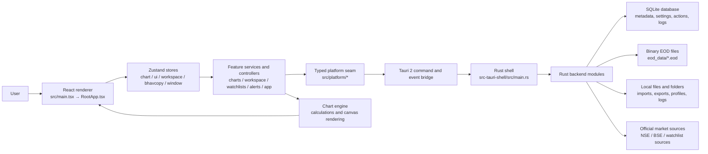
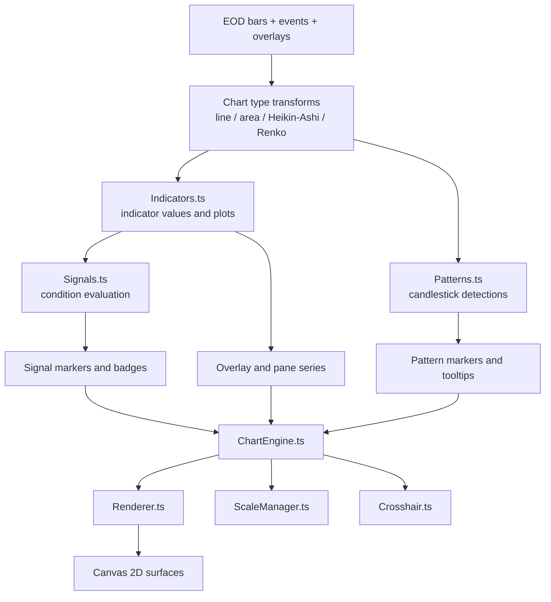
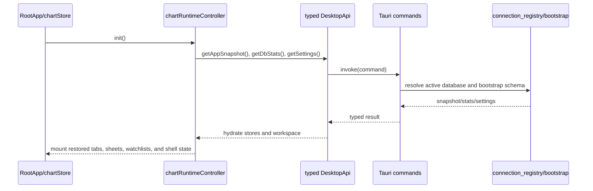

# Current Architecture — EOD Charting Platform

## CA checkpoint; no architecture change — 26 October 2026

This checkpoint changes documentation only. Native/persisted evidence now covers
4,288 explicit approvals across NSE/BSE, including Split/Bonus. This supersedes
older unproven-bulk/Split statements for this observed run only. Transaction-time
checks and targeted related-event refresh remain the intended design. Whole-table
Checking and silent progress were observed; their cause is unresolved and is not
proof of a full rescan. CA is paused for the user-reported database issue.

This checkpoint supersedes older current-status claims below.
See [CA resume checkpoint](docs/changes/2026-10-26_CA_PAUSE_DATABASE_PRIORITY_HANDOFF.md).

## Corporate Actions renderer update — 25 October 2026

This dated update supersedes older CA acceptance statements below. The classic
queue filters loaded identity fields locally; quick search never invokes Fetch,
Load & Validate or financial approval. Exact symbols rank before prefixes and
broader identity matches, followed by the selected column order. Details retains
ISIN, official terms/source evidence and blocker explanations.

Successful explicit approval reconciles exact stored rows for the selected
symbol/full-ISIN group, verifies related remaining events, and carries unrelated
evidence into a new renderer generation. Old confirmations expire. The rejected
full automatic rescan is removed; uncertain dispatch/refresh still fails closed.
Rust transaction checks and raw-price immutability contracts are unchanged.

User native evidence confirms selected Dividend commits, 4/2-second targeted
refreshes, search filtering/ranking/ISIN/empty results and user-reported Esc/× clear.
This does not establish chart-price arithmetic, bulk/Split or BSE transport
acceptance. See [handoff](HANDOFF.md),
[refresh](docs/changes/2026-10-25_CA_POST_APPROVAL_QUEUE_REFRESH.md) and
[search](docs/changes/2026-10-25_CA_QUICK_SEARCH.md) for exact limits.

<!-- EOD-CANONICAL-STATUS-2026-10-17-R1 -->
## Current verified platform and Corporate Actions status — 17 October 2026 IST

**Normal CA data/control path:** official NSE/BSE action intake → existing active CA dialog → Load & Validate with exchange/security matching and actual EOD trading bars → explicit operator approval → Rust transactional ledger write → existing database-change/chart cache refresh contracts. Future or missing-EOD events fail closed. No raw historic OHLCV rewrite was introduced.

**Integrated Corporate Actions R1:** approved normal workflow `Fetch from Officials → Load & Validate → Approve Ready`, implemented in the existing CA window without replacing advanced maintenance. Load does not automatically approve Split/Bonus. Future ex-dates remain scheduled and local EOD readiness must be satisfied before explicit operator approval; the backend rechecks readiness at approval. Existing adjustment ledger/transactions and chart-refresh hooks are preserved, but production write/refresh behavior has **not** been manually accepted.

**Current acceptance boundary (17 October 2026 IST):** source-integrated and native-validation **PASS** (62/62 focused Vitest, 2/2 focused Rust tests, renderer typecheck, frontend Vite build, offline Cargo check). Two isolated Windows release builds also **PASS**; the static-CRT EXE has no direct/delay VC runtime imports. **Desktop CA UI and chart-refresh acceptance remain NOT VERIFIED:** the first disposable Sandbox run lacked Visual C++ CRT DLLs, the static-CRT attempt then lacked WebView2 Runtime. Operator stopped; no manual CA pass, no real NSE/BSE network-fetch pass, no production CA write acceptance, and no portable installation acceptance.

**Plugin P5-FINAL:** metadata-only import/discovery/reload architecture is closed with third-party external JavaScript evaluation and activation still **DISABLED**. C2 did not prove production guest process/IPC isolation; no plugin activation is permitted by the CA documents. The three previously unattributed P1/P2 files were accepted by exact isolated reconstruction on 17 October.

**Architectural boundary:** a successful test build is not a manual observation of chart refresh or production transactional recovery. External JavaScript plugins stay disabled.
<!-- END-EOD-CANONICAL-STATUS-2026-10-17-R1 -->

<!-- STANDALONE-PLUGIN-ARCHITECTURE-P1-P3-2026-10-16:BEGIN -->
## Standalone External Plugin Architecture and SDK — P1–P3 status

- **Design boundary:** The EOD Charting Platform remains the protected core. Plugin Manager owns generic lifecycle controls; each plugin owns its own menu-opened interface and settings. External developers should integrate through the SDK and host interfaces rather than editing platform core code.
- **P1/P2 implemented components (reported, not independently reaccepted here):** `src/plugins/pluginHost.ts`, `src/plugins/types.ts`, `src/plugins/pluginLoader.ts`, `src/engine/ChartEngine.ts`, `src/components/SettingsDialog.tsx`, and `src-tauri-shell/src/plugin_data.rs` provide extension registrations, loading and user-facing controls. The SDK is in `packages/eod-plugin-sdk/` with a development sample plugin.
- **P3 accepted import-cycle fix (15 October 2026):** `src/plugins/hostRuntime.ts` owns the shared runtime singleton. Plugin registries, dynamic indicator registrations and scanners integrate through the lightweight host. The accepted P3 evidence records renderer typecheck PASS, six focused Vitest suites **22/22 PASS**, and renderer Vite build PASS; see `docs/changes/2026-10-15_1740_IST_P3_PLUGIN_IMPORT_CYCLE_LEAN_FIX_R1.md`.
- **P4 boundary:** This section records implementation state and verified P3 evidence. It does **not** establish a full installed external-plugin lifecycle, production/manual activation, security review or portable Tauri build. Existing charts, CA functionality and database behavior remain protected. Corporate Actions write activation is not authorized here.
<!-- STANDALONE-PLUGIN-ARCHITECTURE-P1-P3-2026-10-16:END -->


<!-- BHAVCOPY-MODULAR-REFACTOR-PHASES-1-TO-9-2026-10-15:BEGIN -->
## Completed — Bhavcopy Modular Architectural Refactor Phases 1–9 (2026-10-15 00:50 IST)

- **Classification:** `MODULAR_CODE_HYGIENE_AND_ARCHITECTURE_REFACTOR__ALL_VALIDATION_GATES_PASSED`
- **Plan Artifact:** `BHAVCOPY_MODULAR_REFACTOR_PLAN.md`
- **Core Outcome:** Decomposed the ~7,980-line monolithic `src-tauri-shell/src/bhavcopy.rs` into a structured, highly maintainable subpackage (`src-tauri-shell/src/bhavcopy/`) with zero regressions and 100% backward compatibility for all 8 public Tauri IPC commands.

### Module Topology:
1. **`src-tauri-shell/src/bhavcopy/mod.rs` (1,118 lines):**
   - Public facade: `download_bhavcopy` (single) and `download_bhavcopy_batch` (batch).
   - Task worker pools, channel coordination, and batch planning execution.
2. **`src-tauri-shell/src/bhavcopy/types.rs` (246 lines):**
   - Core domain types: `BhavcopySettings`, `BatchDownloadConfig`, `DownloadResult`, `DownloadTask`, `StagedDownload`, `AppResult<T>`.
3. **`src-tauri-shell/src/bhavcopy/settings.rs` (194 lines):**
   - Persistent settings commands: `get_bhavcopy_default_templates`, `get_bhavcopy_settings`, `save_bhavcopy_settings`.
   - Settings validation, default configurations, and series exclusion normalizers.
4. **`src-tauri-shell/src/bhavcopy/transport.rs` (193 lines):**
   - HTTP/1.1 client configuration, connection pooling (10s idle, max 4 per host), session warming, candidate streaming, and causal error chain diagnostics.
5. **`src-tauri-shell/src/bhavcopy/calendar.rs` (455 lines):**
   - Market holiday commands: `list_market_holidays`, `add_market_holiday`, `delete_market_holiday`.
   - Special trading session overrides (Muhurat, disaster-recovery sessions), date math, 18:00 IST evening probe cutoff.
6. **`src-tauri-shell/src/bhavcopy/sources/` (308 lines):**
   - `sources/mod.rs`: `Candidate`, `CandidateKind`, `apply_template`.
   - `sources/nse.rs`: NSE Equity & Index candidate generators and referer headers.
   - `sources/bse.rs`: BSE Equity (UDiFF & legacy ZIP) & BSE Index candidate generators and referer headers.
7. **`src-tauri-shell/src/bhavcopy/parsers/` (722 lines):**
   - `parsers/zip.rs`: Bounded ZIP archive extractor with 128 MB security guard.
   - `parsers/json.rs`: BSE Index Arch JSON & NSE historical API row normalizers.
   - `parsers/csv.rs`: NSE/BSE UDiFF CSV parser, legacy EQ parser, IndexSummary parser.
   - `parsers/mod.rs`: `ParsedBhavcopyRow`, `ParsedBhavcopyFile`, duplicate symbol-date row detection.
8. **`src-tauri-shell/src/bhavcopy/ingestion.rs` (3,409 lines):**
   - SQLite download log tracking, transactions, and storage mode pre-filter queries.
   - Durability-governed binary writer pool (`write_bhavcopy_binary_records_parallel` preserving 2-worker default and 4-worker maximum cap).
   - Recovery journal session lifecycle: `prepare_bhavcopy_recovery_session`, `capture_recovery_binary_baselines`, `recover_pending_bhavcopy_sessions`, background checkpoint worker.
   - Fast-path baseline classification & shadow inspection engine.
9. **`src-tauri-shell/src/bhavcopy/tests.rs` (1,478 lines):**
   - Isolated unit tests covering parser parity, shadow classification, durability baselines, date window boundaries, and candidate URL templates.

### Validation Passed:
- `cargo test --bin eod-charting-platform-shell -- bhavcopy::tests::`: **50/50 PASS** (0.77s, 0 compiler warnings).
- `npm run typecheck:renderer`: **PASS** (0 errors).
<!-- BHAVCOPY-MODULAR-REFACTOR-PHASES-1-TO-9-2026-10-15:END -->

<!-- TECH-AUDIT-PHASES-1-TO-5C-2026-10-14:BEGIN -->
## Completed — Technical Audit & Internal Hardening Phases 1A-5C (2026-10-14 19:10 IST)

- **Classification:** `INTERNAL_PERFORMANCE_STORAGE_IPC_AND_SECURITY_HARDENING__ALL_VALIDATION_GATES_PASSED`
- **Report:** `docs/changes/2026-10-14_1910_IST_TECHNICAL_AUDIT_PHASES_1_TO_5C_COMPLETE.md`

### Key Deliverables:
1. **Multi-Layer Canvas & Memory Lifecycle (Phases 1A & 1B):**
   - Reused `cachedRenderState` in `ChartEngine.getPointerState()` and isolated crosshair/synced-crosshair/drawing-preview repaints strictly to `overlayCanvas` (`src/engine/ChartEngine.ts`, `src/components/ChartCanvas.tsx`, `src/engine/__tests__/ChartLayerPartition.test.ts`).
   - Added `blur`, `pointercancel`, and window close/minimize/maximize drag-listener teardown in `src/components/FloatingWindow.tsx` and `src/components/common/useDraggableFloatingWindow.ts`; zeroed detached `<canvas>` buffers on `unmount()`.
2. **Windows Storage Lock Resilience & Single-Handle Reuse (Phase 1C):**
   - Eliminated duplicate `OpenOptions::open` calls in `src-tauri-shell/src/database/binary_eod.rs` (`upsert_single_record_by_date` & `rewrite_from_first_incoming_record`) and added bounded retry backoff for transient Windows `ERROR_SHARING_VIOLATION` (`os error 32`) and `os error 5` in `binary_eod.rs` and `src-tauri-shell/src/bhavcopy_recovery.rs`.
3. **Full-Series FNV-1a Indicator Cache & Scanner Throughput (Phases 2A & 2B):**
   - Replaced 2-endpoint bar checks in `src/indicators/registry.ts` with an O(N) FNV-1a checksum (`getBarsMutationSignature`) and recursive upstream cache keys (`getChainedIndicatorCacheKey`).
   - Bounded historical pattern evaluation sliding window to 260 bars in `src/plugins/scanner/chartPatternEvaluation.ts`, yielded to the event loop every 8 symbols in `src/plugins/scanner/scannerRunner.ts`, and hoisted `get_price_storage_mode` out of the per-symbol loop in `src-tauri-shell/src/database/daily_market_snapshot.rs`.
4. **Packed 64-Byte Binary Bar IPC, 48-Symbol LRU Cache & Security Hardening (Phases 2C, 3A, 4, 5B & 5C):**
   - Added `get_eod_data_binary` in `src-tauri-shell/src/database/eod_data.rs` and `decodeBinaryEodBars` in `src/platform/binaryEodDecoder.ts` (`src/platform/__tests__/binaryEodDecoder.test.ts`), paired with a 48-entry LRU cache and mutation invalidation in `src/platform/tauriDesktop.ts`.
   - Enabled `is_html_response()` across all exchanges and capped ZIP extraction at 128 MB in `src-tauri-shell/src/bhavcopy.rs`; guarded `open_external` and `fetch_official_watchlist_source` in `src-tauri-shell/src/main.rs`; enabled a production CSP in `src-tauri-shell/tauri.conf.json`; resolved all 7 Rust compiler warnings.
<!-- TECH-AUDIT-PHASES-1-TO-5C-2026-10-14:END -->

## Corporate Action identity-resolution closure — August 24, 2026

<!-- CA-V1.14M.2-AUG24-CANONICAL-CLOSURE -->

> **Corporate Action exact three-row repair closure — 24 August 2026.**
> V1.14M.2 independently re-derived the committed V1.14M.1.1 state from a fresh private read-only snapshot and returned **`FULL_SUCCESS`**. The exact three-row production-candidate repair workstream is therefore **`CLOSED / FULL_SUCCESS`**. This closes only this audited three-row repair tranche; it does not declare all Corporate Action work complete.

- Production Corporate Action source SHA-256: `2e05315fa4bf7fe78f28e787edd2bd9a1fef23fb06cab66cc79c8ede9a1b5cfb`.
- Final repaired imports: `43286 PDSL / INE111Q01013`, `43419 ANDHRAPAP / INE435A01028`, `43501 AVANTIFEED / INE871C01012`.
- All three remain `PENDING_ISIN_MISMATCH` and unapproved; the historical official event ISINs are preserved.
- Old dedupe keys are absent; each new production dedupe key has exactly one owner.
- Target post-state fingerprint: `829f70a4714b24516282399c1ba880c87c0e733841d589a3745a106592ff532a`.
- Non-target import fingerprint: `ef1450c462e1192664ed7c0adad472cb27e79529a88e4d2a7c81c8fec270258a`.
- Protected-table fingerprint: `252c70ac7231c288320b24916ec640cad1c741c4095bbe32efafcffc69f2bbd4`.
- Schema-safety fingerprint: `64246fe499d3093a52901bcddd26447e350cd08eb7457f80227fdd56715a10f2`.
- V1.14M Apply-plan fingerprint: `5981c3ebd141f443af2cf38f69ae3f704c04f97abb039973a45c44635b089f98`.
- V1.14M mutation fingerprint: `153f999d2087d396943cabffadbd3b33817055f2b1874975fb7b8d7c23723821`.
- Independent V1.14M.2 post-audit fingerprint: `817d6bbccbc02fee7b8e28770616f76eb46723c5f273763573ea9dcf6c78daa2`.
- V1.14M.2 report ZIP SHA-256: `d56b3038d55e310ff3555c3821d620c47ab37f56e1b97f5863847d74baf92e99`.
- Integrity: `quick_check=ok`; foreign-key violations `0`; V1.14M.2 database writes `0`.

### Exact-active NSE symbol / historical-ISIN rule

The production NSE resolver preserves an exact active NSE source symbol when an official event ISIN is historical and every ISIN-matched alternative is inactive. The official event ISIN is retained and the candidate remains `PENDING_ISIN_MISMATCH` for review. If any ambiguous ISIN match is active, the resolver remains `UNRESOLVED`; the hardening does not auto-select an active ambiguity, auto-approve an event, invent a symbol-change date, or mutate identity/ISIN history.

The closed V1.14M repair changed only `corporate_action_imports.{dedupe_key,symbol,company_name,review_status,message}` for imports `43286`, `43419`, and `43501`. Independent V1.14M.2 verification proved that evidence, decisions, resolutions, Corporate Actions, identity history, ISIN history, non-target imports, and other protected tables remained unchanged.

## 1. System boundary

EOD Charting Platform is a local-first Windows desktop application for end-of-day Indian-market data. The renderer owns interaction, chart state, technical-analysis calculations, and canvas rendering. The Rust desktop shell owns filesystem access, SQLite lifecycle, binary EOD storage, imports, downloads, native menus, and durable data mutations.



### Architectural invariants

- The active desktop runtime is Tauri 2. There is no active Electron path.
- Renderer code crosses into the desktop shell through `src/platform/*`; components should not add ad-hoc raw Tauri calls.
- SQLite is the metadata, settings, identity, corporate-action, watchlist, and operational-log store. OHLCV history is supported in both SQLite and binary EOD form, with binary storage treated as the active high-volume path where the selected storage mode requires it.
- Corporate-action ingestion remains review-first. Raw `.eod` history and canonical action rows must not be mutated by background UI behavior or automatic approval.
- Frontend chart/workspace state is persisted through explicit workspace serializers and backend settings/layout commands. Persisted field names are compatibility contracts.
- Quote Editor is owned by the main renderer and remains an in-app `FloatingWindow`; it is not a separate native/taskbar webview.
- `eod_binary_state.sqlite` is an acceleration/verification sidecar, not the canonical OHLCV store. A missing row triggers localized fallback; physical `.eod` files remain canonical.

## 2. Runtime and build layers

### Renderer runtime

- Entry point: `src/main.tsx`
- Root composition: `src/RootApp.tsx`
- Runtime: React 18, TypeScript, Vite, Zustand
- Charting: application-owned Canvas 2D engine under `src/engine/*`
- Technical analysis: `technicalindicators` plus application-specific indicator, pattern, signal, and transform logic
- Styling: `src/styles/global.css`, theme tokens from `src/features/app/themeService.ts`, and component-local styles where needed

`RootApp` mounts the persistent shell — toolbar, sidebar, chart tabs, sheets, chart canvas, tool dock, status bar, command palette, toast container, and window tray — and lazy-loads expensive or secondary windows such as database tools, CSV import, bhavcopy, scanner, alerts, layouts, watchlists, help, and settings.

### Desktop shell

- Manifest: `src-tauri-shell/Cargo.toml`
- Tauri configuration: `src-tauri-shell/tauri.conf.json`
- Rust entry point: `src-tauri-shell/src/main.rs`
- Runtime path/profile handling: `src-tauri-shell/src/runtime.rs`, `src-tauri-shell/src/app_profile.rs`
- Frontend development server: Vite at `http://localhost:5173`
- Production frontend artifact: `dist/`, embedded by Tauri configuration
- Build metadata: generated into `src-tauri-shell/gen/build-info.json`

The root scripts provide separate renderer typecheck/build, Rust check, test, Tauri development, Tauri build, NSIS bundle, and portable Windows workflows. The live project routes Cargo output to repository-root `target/` through `.cargo/config.toml`; `scripts/prepare-tauri-portable.ps1` consumes `target\release\eod-charting-platform-shell.exe`, stages it as `release\tauri-portable-win\EOD Chart Portable\EOD Chart.exe`, and fails if source/staged SHA-256 values differ. The August 17 source snapshot includes `.cargo/config.toml`, so the current source snapshot carries the root-target routing required by the portable build topology.

### Production bundle partition (W1.3 / W1.4 / W1.4-B1)

Vite manual chunking remains synchronous/static. The accepted August 17 production chart ownership is:

- `feature-chart-canvas`: exact `src/components/ChartCanvas.tsx` (~206.72 kB minified in the accepted August 22 rollback build).
- `feature-chart-core`: remaining approved chart core (`src/engine/**` except analysis-owned paths, `src/store/chartStore.ts`, `src/features/charts/**`) (~298.43 kB).
- `feature-chart-analysis`: `src/indicators/**`, `src/engine/Patterns.ts`, and `src/engine/candlestick/**` (~164.40 kB).
- `vendor-technicalindicators`: `node_modules/technicalindicators/**` (~19.81 kB).
- `feature-official-watchlists`: lightweight W1.3 feature shell (~55.08 kB), with six source-selective constituent payload families.

No chart-runtime dynamic import or loading-state behavior was introduced by W1.4/W1.4-B1. The old `feature-chart-runtime` monolith is absent. The accepted build contains no application JavaScript chunk above 500 kB and emits neither the circular-chunk warning nor the Vite CJS Node API deprecation warning.

## 3. Frontend architecture

### 3.1 Composition and UI layer

`src/components/*` contains UI and window surfaces. Important boundaries are:

- `RootApp.tsx`: application composition, startup theme/settings application, window visibility, and lazy-window mounting.
- `ChartCanvas.tsx`: chart surface, pointer/keyboard interaction, viewport coordination, drawing interaction, crosshair, overlays, and engine invocation. It is the main frontend hotspot.
- `Toolbar.tsx`, `Sidebar.tsx`, `ChartTabs.tsx`, `SheetTabs.tsx`, `ChartToolDock.tsx`, `StatusBar.tsx`, and `WindowTray.tsx`: persistent shell controls.
- `FloatingWindow.tsx`: shared modeless in-app window behavior used by secondary surfaces, including Quote Editor. The separate native `quote-editor` WebviewWindow experiment was rejected and rolled back.
- `ChartContextMenu.tsx`, `ChartSettingsDialog.tsx`, `ChartSettingsMenu.tsx`, and drawing dialogs: chart-local settings and actions.
- `ChartToolDock.tsx` + `DrawingToolGroups.ts`: compact drawing-tool navigation. Cursor/Crosshair remain direct controls; all 49 persisted drawing kinds are partitioned into nine stable families. Each family remembers its last-used tool locally and opens a name-only flyout without changing drawing IDs, geometry, or workspace persistence.
- `ScannerWindow.tsx`, `AlertManagerWindow.tsx`, `BhavcopyDownloadWindow.tsx`, `DatabaseToolsDialogs.tsx`, `ImportCsvDialog.tsx`, and watchlist/database dialogs: feature windows that consume store and platform contracts.

The component layer should render state and dispatch typed store/feature actions. Durable data access belongs behind the feature or platform layers.

### 3.2 Zustand state layer

| Store | Responsibility | Durable or transient state |
|---|---|---|
| `src/store/chartStore.ts` | Active database snapshot, chart tabs, symbol loading, timeframes, chart types, indicators, drawings, panes, viewport, sheets, watchlists, progress, toasts, and runtime orchestration | Mixed; chart/workspace state is serialized, progress/UI state is transient |
| `src/store/uiStore.ts` | Dialog/window flags, sidebar/status-bar visibility, drawing tool state, compare/scanner/alert overlays, theme selection, screenshot requests, and transient interaction state | Mostly transient; selected settings are delegated to app settings services |
| `src/store/workspaceStore.ts` | Shell geometry and workspace chrome such as sidebar width, collapsed/pinned state, and layout-level UI preferences | Persisted through workspace/settings pathways where configured |
| `src/store/bhavcopyStore.ts` | Bhavcopy settings, batch configuration, progress, per-date results, and source/log presentation state | Mixed; settings are durable, progress/results are transient |
| `src/store/windowStore.ts` | Bounds, minimized/maximized, z-order/focus, and visibility state for floating windows | Session/UI state |

`chartStore.ts` is an orchestration shell, not the intended home for every chart operation. It delegates to focused controllers/services such as `chartRuntimeController`, `chartTabSessionController`, `chartInstrumentCompareController`, `chartSearchController`, `chartTabStateMutationService`, `chartIndicatorPaneService`, `watchlistStoreController`, and `chartSnapshotHydrationService`.

### 3.3 Feature services

#### App

`src/features/app/*` owns app-profile settings, theme registration/application, version history, and native menu command routing. `menuCommandRouter.ts` translates `menu:*` events into chart-store or UI-store actions.

#### Charts and workspace

`src/features/charts/*` owns chart-specific orchestration that would otherwise overload the store:

- instrument loading, resolved-symbol hydration, and the module-level EOD cache;
- compare-overlay loading and timeframe synchronization;
- symbol search/browser shaping;
- chart tab/session creation, activation, closing, and layout restoration;
- pane heights, collapse state, scale overrides, indicator mutation, drawings, viewport, chart type transforms, Renko settings, and screenshot/export helpers.

`src/features/workspace/*` owns application bootstrap, database lifecycle refresh, snapshot hydration, settings/layout persistence, and workspace serialization. The workspace format is versioned and must be treated as a compatibility boundary.

#### Watchlists

`src/features/watchlists/*` splits manual watchlist CRUD orchestration from official-source resolution. Provider definitions, generated official datasets, live-source fallback, symbol matching, navigation, source-linked replacement, and store wiring are separate seams. Official Watchlists now use a lightweight synchronous six-source metadata catalog plus source-selective lazy constituent payload modules. Successful payload promises are session-cached with in-flight deduplication; rejected promises are evicted so retry remains possible. Existing live-source fetch with packaged-snapshot fallback semantics remain unchanged.

#### Alerts

`src/features/alerts/*` defines EOD alert evaluation and indicator-facing contracts. Chart-local rules, scanner-match rules, indicator threshold/crossover rules, and drawing-line alerts converge on persisted alert state and scan/trigger history exposed by `AlertManagerWindow` and chart/scanner surfaces.

## 4. Chart and analysis engine

The chart engine is a renderer-independent domain layer consumed by `ChartCanvas`.



### Engine responsibilities

- `ChartEngine.ts`: owns chart layout, panes, viewport-to-bar mapping, pointer state, scales, crosshair state, and calls into render helpers.
- `Renderer.ts`: draws axes, grids, candles/bars/areas, indicator series, volume, events, drawings, pattern markers, signals, labels, legends, and tooltips.
- `DrawingGeometry.ts`, `DrawingAdvancedGeometry.ts`, `DrawingMultiAnchorGeometry.ts`, `DrawingD3BGeometry.ts`, `DrawingD3CGeometry.ts`, `DrawingF1BGeometry.ts`, `DrawingF1CGeometry.ts`, `DrawingF1DGeometry.ts`, `DrawingF1EGeometry.ts`, and `DrawingLabelLayout.ts`: native drawing geometry/layout helpers. D1 contains line/range geometry; D2 adds regression/Fibonacci/Gann/shape helpers; D3A adds generalized 3/4-anchor counts plus channel, rotated-rectangle, polygon, and arc geometry; D3B reuses that anchor model for pitchfork and advanced three-anchor Fibonacci geometry; D3C adds chart-only long/short risk-reward planning and measured A-B-to-C projection geometry. The F1 family adds explicit TradingView-fidelity Fibonacci geometry: F1B level/runtime/autoscale helpers, F1C Circles/Speed Resistance Arcs/data-space Wedge, F1D accepted Spiral geometry, and F1E Speed Resistance Fan geometry. D3C.1 keeps label layout renderer-native: horizontal Fib/fan labels can be offset above their strokes with viewport-safe vertical flipping, and Long/Short Position lines reserve an inline text gap so the stroke does not run through the annotation.
- `UnifiedStyleContracts.ts` + `DrawingStyleSchema.ts`: Settings S1 common visual-style foundation, now first consumed by Settings S2.1. Shared line/plot/fill/text/label/timeframe-visibility contracts are reusable by drawings and indicators. Every one of the 49 persisted drawing kinds has a declarative style schema with line/fill roles, a coordinate mode, `Style | Coordinates | Visibility` tab metadata, and backward-compatible resolvers. S2.1 activates component-level Style resolution for Regression Trend, Parallel Channel, Flat Top/Bottom Channel, and Disjoint Channel. S2.2 extends the same shared UI/renderer path to Andrews’, Schiff, Modified Schiff, and Inside Pitchfork plus Pitchfan; each pitchfork resolves Median/Upper/Lower independently, while Pitchfan resolves its six Fibonacci rays independently. S2.3 extends the same resolver/UI path to the planned Fibonacci/Gann family: Trend-Based Fib Extension, Fib Channel, Trend-Based Fib Time, Fib Wedge, Fib Time Zone, Fib Circles, Fib Arcs, Gann Box, Fib Retracement, Fib Extension, Fib Fan, and Gann Fan. Level/ray/arc/circle/grid components now resolve independent visibility/color/width/style/opacity while legacy emphasis and default fill behavior remain encoded in the schema. Settings S2.3.1 hardens the shared Properties shell after portable visual acceptance: ordinary drawings use `Style | Coordinates | Visibility`, Long/Short Position use `Inputs | Style | Visibility`, the dialog is draggable/resizable with persisted bounds, individual line colors are always editable without a visible one-color gate, and D/W/M/Q/Y visibility is enforced by ChartEngine rendering/hit-testing. Fib Retracement now uses clean endpoint-aligned labels and optional per-band low-opacity backgrounds derived from level colors. Long/Short anchors are normalized to directional invariants before render/edit, and their renderer uses target/entry/stop component styles plus target/stop zones and compact statistics.
- `drawingTimeframeAnchorService.ts`: remaps persisted drawing indexes by stable timestamps across Daily/Weekly/Monthly/Quarterly/Yearly display-bar changes while retaining original timestamp identity for deterministic round trips.
- `src/features/drawings/drawingTemplates.ts` & `src/components/FavoriteToolsToolbar.tsx`: Drawing template management engine enabling users to save, name, apply, and designate default visual styles per drawing tool kind from `ChartDrawingPropertiesDialog.tsx`. `FavoriteToolsToolbar.tsx` provides a floating, draggable quick toolbar with active-tool indicators and horizontal/vertical orientation toggle; interactive star ⭐ icons in `ChartToolDock.tsx` flyouts pin/unpin favorites into the floating bar.

#### Accepted Fibonacci geometry boundary

The Fibonacci family is closed at the F1E.1 checkpoint and is a protected regression baseline for Gann work. The current internal family contains eleven persisted kinds. `fibWedge` authors its canonical curves in data coordinates before viewport projection. `fibSpiral` uses the restored F1D.1 persisted perpendicular basis; the rejected F1D.2 `basisPerpTime` / `timeDeltaMs` absolute-time experiment is not part of the accepted architecture. `fibFan` uses `DrawingF1EGeometry.ts`: each price/time Fibonacci target is computed from the stored anchor data, both apex and target are projected through the current scales, and the already-projected ray is extended beyond the pane for canvas clipping. Renderer and hit-testing consume the same F1E geometry builder, which is the accepted fix for same-timeframe zoom/auto-scale ray drift. The internal kind remains `fibFan` for workspace compatibility even though the accepted F1E behavior is Fib Speed Resistance Fan geometry.

- `src/indicators/*` & `src/engine/Indicators.ts`: Fully decentralized modular indicator architecture. Each of the 118 indicators (standard and community) lives in its own `.ts` module under `src/indicators/standard/` or `src/indicators/community/`. `registry.ts` maps kinds to builders (`INDICATOR_REGISTRY`) and isolates renderable computation with a `WeakMap`-backed cache bucket keyed on mutation signatures and indicator configuration. `catalog.ts` provides searchable metadata, labels, and category groups. `Indicators.ts` serves as a backward-compatible facade re-exporting the indicator subsystem.
- `src/engine/candlestick/*` & `Patterns.ts`: Japanese Candlestick Patterns engine detecting all 44 official TradingView candlestick patterns categorized explicitly into Single-Candle (15), Two-Candle (15), and Multi-Candle (14) patterns with PineScript C_ properties vectorization (14 EMA body smoothing, shadow ratios, trend slopes, and range metrics). `Patterns.ts` exposes backward-compatible detection helpers and category metadata.
- `Signals.ts`: evaluates bar-by-bar signal conditions and returns renderable signal markers.
- `ScaleManager.ts`: manages price and pane scales, manual overrides, log/inverted modes, and visible-data fitting.
- `Crosshair.ts`: maps pointer position to bars and synchronizes date-based crosshair state across chart panes/grid cells.
- `DataConflation.ts`, `VolumeProfile.ts`, and `Heatmap.ts`: specialized data/render helpers.
- `valueLabelSettings.ts` and `types.ts`: shared chart contracts, display settings, chart events, drawings, indicators, signals, themes, panes, and viewport types.

### Chart state model

Each `ChartTabState` contains the instrument identity, raw/display bars, timeframe, chart type, adjusted/raw mode, viewport, compare overlays, indicators, drawings, pane settings, visual settings, event visibility, future margin, and per-tab sheets. Indicator instances use stable unique IDs so multiple studies of the same kind can coexist. Overlay indicators render on the price pane; oscillator/volume-style indicators render in dedicated panes with independent height/collapse/scale settings.

Drawing state remains serialized through the existing `ChartDrawing` union. Phase D1/D1.1 added one/two-anchor tools plus optional stable timestamp identities; Phase D2 extends the same persisted model with advanced one/two-anchor tools. D2.1 adds `drawingScopes`, a per-sheet map keyed by canonical `EXCHANGE:SYMBOL`, while `drawings` remains the currently active collection. Symbol changes snapshot the active collection before activating the target instrument scope, and sheet serialization persists each sheet's complete scope map. Legacy version-1 workspaces without `drawingScopes` migrate their active `drawings` into the current instrument scope during restore. Existing drawing kind semantics are not migrated or renamed, locked drawings remain removal-protected, and Properties uses one consistent draft-color → Save commit path. `DrawingCapabilities.ts` centrally declares reusable Extend Left/Extend Right and Show Label support so those controls are exposed only where geometry/rendering supports them and can be extended to later D3-D5 tools. D3A introduces `DrawingAnchor[]` only for new multi-anchor drawing kinds while leaving all existing one/two-anchor persisted schemas unchanged; this preserves version-1 workspace compatibility. D3B reuses the same three-anchor representation for four pitchfork variants and five advanced Fibonacci tools, so creation/editing/timeframe/Renko behavior remains centralized rather than tool-specific. D3C reuses the same representation for Long Position, Short Position, and Projection. Position anchors are Entry → Target/end-time → Stop, with Target and Stop normalized to one shared end-time boundary; Projection stores A/B/C and derives D from the full A→B price/time vector. These are persisted drawings only and have no broker/order side effects. The grouped Drawing Tool Dock is presentation-only: it partitions the existing 49 persisted kinds into Lines, Channels, Pitchforks, Fibonacci/Gann, Shapes, Measure/Projection, Positions, Arrows/Markers, and Text. Per-group last-used selection is stored as UI-only local state and never enters `ChartDrawing` serialization. D3C.1 does not change drawing schemas: Fib/level readability is improved by label-to-line spacing and stronger typography, while Long/Short Position uses split level strokes around centered Target / Entry+R:R / Stop text instead of floating debug-style annotations.
Settings S1 extends the optional drawing base contract with `presentation` (per-line/fill/text/label overrides plus `useOneColor`) and `visibility` (master + D/W/M/Q/Y overrides). Both fields remain optional and workspace serialization preserves drawing objects by value, so legacy workspaces require no migration. Existing indicator `IndicatorPlotSettings`, `IndicatorLevelSettings`, and `BandFillSettings` derive from the same unified contracts without changing their current indicator Settings behavior. Settings S2.1 is the first renderer/UI binding: Regression Trend plus the three Channel tools resolve named line/fill slots into independent visibility/color/width/style/opacity controls. Legacy defaults are encoded in the schema, including Regression Basis solid/1.5px fallback, Parallel Channel Middle dashed geometry, and legacy fill visibility. S2.2 reuses that same generic Properties surface for four Pitchfork variants and Pitchfan without introducing tool-specific dialogs. Pitchfork Median defaults to full opacity while Upper/Lower retain the legacy 0.9 emphasis; Pitchfan preserves the legacy strong 38.2/50/61.8% rays and 0.65 secondary-ray opacity while making every ray independently configurable. S2.3 keeps that generic UI and adds declarative level/ray/arc/circle/grid slots for Fibonacci/Gann tools. Trend/construction lines are separately addressable where they already existed; Fib Channel preserves its 1.0/0.65 legacy emphasis, Trend-Based Fib Time preserves 1.0/0.6 emphasis, Fib Wedge preserves 1.0/0.55 level emphasis plus its 6% legacy fill, and Gann Box preserves 62% internal-grid / 80% diagonal emphasis. Optional fills for previously unfilled Fib/Channel/Gann surfaces default OFF to avoid workspace visual changes. S2.3.1 preserves the legacy `useOneColor` persistence field only as a compatibility input; opening an advanced drawing resolves the currently effective shared color into direct per-line draft colors and saves with the shared-color gate disabled. This prevents hidden color overrides while retaining old workspace readability. The Properties Coordinates tab edits one/two-point coordinates precisely and displays multi-anchor points read-only in this correction phase; position price inputs are handled by the dedicated Inputs tab.

Supported chart transforms include candles, line, area, bar, baseline, HLC area, Heikin-Ashi, and Renko. Renko generation is deliberately bounded and reports source/dialog-origin failures instead of silently producing unbounded output.

### Rendering performance and layout ergonomics

- **Overlay dirty tracking:** `ChartEngine.ts` employs an `isOverlayDirty` guard. When the chart is idle (no pointer motion, tool action, or viewport change), continuous RAF overlay clears and redraws are skipped, reducing idle CPU usage by up to 70–90%.
- **Right-rail tool dock:** `ChartToolDock` is anchored on the right edge of the chart canvas adjacent to the price scale, with tool flyout palettes opening leftward over the canvas.
- **De-cluttered top toolbar:** Toolbar controls are organized into four discrete functional clusters (Timeframe | Chart Type & Volume | Indicators & Signals | Pattern Scanners) with unified 24–26px button heights.
- **Modernized status bar:** `StatusBar.tsx` runs at 24px height with 11px typography, featuring high-contrast mono badges for database state, date range, active instrument, bar count, and IST time.

## 5. Scanner and alert architecture

### Scanner plugin model

`src/plugins/scanner/*` is a renderer-side scanner subsystem. `scannerPlugin.ts` registers scanner definitions; `scannerRunner.ts` executes them over a selected universe; `scannerWorkspace.ts` persists scanner configuration; and `ScannerWindow.tsx` provides the UI.

Scanner families include:

- core OHLCV scanners for common price/volume conditions;
- daily market presets: top gainers, top losers, volume surge, 52-week highs, and 52-week lows;
- indicator/signal scanners for crossovers, RSI behavior, and persisted custom signal rules;
- chart-pattern scanners and `scannerPatternMap.ts` for geometry, priority, projections, and chart overlays;
- worker-backed pattern evaluation through `chartPatternEvaluation.worker.ts` and `chartPatternWorkerClient.ts` to keep expensive scans off the UI thread.

The scanner runner normalizes target universes, deduplicates symbols, applies configured history limits, invokes scanner definitions, and returns ranked results. A result can navigate directly to a chart or create a chart overlay containing levels, markers, target projections, and supporting metadata.

### Forecast plugin and precomputed adapter

`src/plugins/forecast/dnnTrend/*` is a bundled renderer-side forecast plugin that remains disabled by default. The plugin registry preserves the existing Core EOD Scanner default while the DNN adapter can be enabled only after Settings validates a configured precomputed prediction source. No forecast code is placed inside the chart engine.

The forecast domain now contains two replaceable provider routes:

- the deterministic mock provider retained for contract and lifecycle tests;
- `PrecomputedDnnTrendInferenceProvider`, which serves exact, externally generated predictions from a validated UTF-8 JSON source.

The V1 precomputed source contract is `dnn-trend-predictions-v1`; a matching machine-readable JSON Schema is stored under `resources/dnn-trend/`. It requires versioned model and feature metadata, explicit production-readiness metadata, a dataset revision, exact `1D` as-of dates, supported 5/10/20-session horizons, and three probabilities that sum to one. Unknown fields and duplicate exact keys are rejected. Missing-date diagnostics can reference only an earlier causal prediction and never fall forward to a future record. Lookup is fail-closed for missing dates, stale dates, revision mismatch, feature-version mismatch, unsupported horizons, malformed probabilities, oversized files, unsupported file extensions, and non-UTF-8 input.

Application-profile settings persist generic `pluginConfigurations`, allowing bundled plugins to own versioned configuration without adding a new top-level setting for each future plugin. The DNN adapter currently stores only its selected prediction-source path. `src-tauri-shell/src/plugin_data.rs` provides bounded generic plugin-data file selection and UTF-8 text reading plus a generic native output-folder picker; it enforces an extension allow-list and a hard 32 MiB ceiling for reads, while the DNN adapter applies a 16 MiB input limit.

Settings contains a read-only viewer for exact symbol, exchange, date, and horizon lookup. It can copy the active chart identity/date into the query, but it does not modify chart bars, draw overlays, trigger scans, or submit orders. The plugin checkbox remains unavailable until the source passes validation. Clearing or invalidating the source forces the plugin disabled.

DNN Research Dataset Export V1 is a separate read-only backend route in `src-tauri-shell/src/database/dnn_research_export.rs`. It opens the active database with SQLite `query_only`, resolves instrument identity history to a canonical current symbol, reads the same hybrid/binary OHLCV path used by the chart backend, applies the platform corporate-action adjustment engine according to manifest-recorded options, and atomically publishes a unique external dataset directory only after all output writers and the manifest are complete. The directory contains `dataset-manifest.json`, `instruments.csv`, `daily-bars.csv`, `corporate-actions.csv`, and `failures.csv`. Full-export defaults cover NSE and BSE, the complete available date range, inactive instruments, capital-action-adjusted bars, and no dividend or rights adjustments. Per-instrument data failures are explicit; output-I/O failures abort and remove the staging directory. Progress is emitted as `dnn-research-export:progress`.

The export contract is `dnn-research-dataset-v1`; its JSON Schema and field documentation live under `resources/dnn-trend/`. CSV was chosen for zero new runtime dependencies, auditability, and external-tool interoperability. Exported datasets must be written outside source-code directories and consumed by a separate research/training workspace. The desktop app does not train, select, calibrate, or execute a model.

The existing causal feature builder, probability validation, revision-aware memory cache, cancellation, disposal, and inference-service contracts remain available for a future local model. Training, model selection, calibration, ONNX/Python runtimes, automatic chart-time inference, historical chart overlays, scanner ranking, external folder plugins, broker routes, and order execution remain out of scope. Dataset-export cancellation and cryptographic content hashing are also not part of V1.

### Formal plugin host and lifecycle sandboxing

`src/plugins/pluginHost.ts` provides a runtime execution engine for plugins:

- **Formal lifecycle contracts (`src/plugins/types.ts`):** Defines `PluginContext`, `ChartPluginLifecycle` (`init`, `destroy`, `onBarsUpdated`, `onInstrumentChanged`), `PluginRuntimeInfo`, and `PluginLogEntry`.
- **Fault isolation:** Every lifecycle hook and event notification is wrapped in error-boundary blocks. A runtime exception thrown inside a plugin is trapped in `lastError` and isolated log buffers; it cannot crash the chart canvas, stall the renderer, or impact other active plugins.
- **Platform integration:** `src/plugins/registry.ts` exports a singleton `pluginHost` pre-registered with built-in plugins (`coreEodScannerPlugin`, `dnnTrendPlugin`, `gannPriceTimePlugin`) while retaining full backward compatibility for `listBuiltInPlugins()`, `getBuiltInPlugin()`, `isPluginEnabled()`, and `SettingsDialog`.

### Market Movers batch model

Market Movers is a separate shared snapshot workflow built on the scanner metric definitions:

- `src-tauri-shell/src/database/daily_market_snapshot.rs` owns full-universe retrieval, a dedicated read-only SQLite connection, bounded history, progress events, cancellation, and failure accounting.
- `src/plugins/scanner/dailyMarketScanners.ts` remains the calculation source for daily change and 20-session relative volume.
- `marketMoversSnapshotService.ts` selects the common modal market date, excludes stale/invalid/insufficient rows, classifies corporate-action warnings, and ranks deterministically.
- `marketMoversSnapshot.worker.ts` and its client move ranking/filtering off the renderer UI thread.
- `marketMoversStore.ts` shares one snapshot and one request across Sidebar and ScannerWindow, exposes dirty state, coalesces duplicate requests, and supports request-scoped progress/cancellation.
- Opening either view does not scan. `Scan`, `Update`, and `Cancel` are explicit user actions; previous results remain visible while updating.

### Alert model

Alerts are persisted EOD rules, not only visual chart annotations. The evaluation path supports price conditions, indicator conditions, scanner-match rules, and drawing-derived horizontal-line/trendline/ray conditions. `indicatorAlertContracts.ts` defines the supported close/EMA/RSI/MACD-facing inputs, while `eodAlerts.ts` evaluates rules and records trigger/history information. `SignalSettingsDialog.tsx` configures visual crossover signals; `AlertManagerWindow.tsx` manages durable alert rules and history.

## 6. Platform seam and command/event contracts

The platform boundary is split into two typed APIs:

- `src/platform/desktop.ts` selects the available runtime and exposes `getDesktopApi()` / `requireDesktopApi()`.
- `src/platform/tauriDesktop.ts` implements `invoke()` calls and Tauri event listeners.
- `src/platform/shell.ts` handles native menu commands, app information, external links, and shell-only events.
- `src/platform/types.ts` narrows the desktop bridge and re-exports the data contracts from `src/types/desktop.ts`.

The Rust command registry is assembled in `src-tauri-shell/src/main.rs` through `tauri::generate_handler!`. Current command groups are:

| Command group | Main Rust ownership |
|---|---|
| App/profile/runtime and native menu state | `main.rs`, `app_profile.rs`, `runtime.rs` |
| Database create/open/activate/close/delete, snapshot, stats | `database.rs`, `database/connection_registry.rs`, `database/bootstrap.rs` |
| Symbol search/list and EOD retrieval | `database/symbol_search.rs`, `database/eod_data.rs` |
| Daily Market Movers batch snapshot, progress, and cancellation | `database/daily_market_snapshot.rs` |
| Quote editor, range/date deletion, merge, corporate-action application | `database/quotes.rs`, `database/instrument_mutations.rs` |
| NSE/BSE identity imports and official source resolution | `database/nse_identity_imports.rs`, `database/bse_identity_imports.rs`, `database/official_source_urls.rs` |
| Corporate-action import, evidence, review, resolution, backfill, scan | `database/corporate_action_imports.rs` and `database.rs` contracts |
| Watchlist CRUD and source-linked replacement | `database/watchlists.rs` |
| CSV import/export and chart-image export | `imports.rs` |
| NSE/BSE bhavcopy download, parsing, holiday planning, logging, binary writes | `bhavcopy.rs` |
| Saved layouts and generic settings | `database/settings.rs` |
| Binary EOD status, parity, migration, and storage mode | `database/binary_eod.rs`, `database/storage_mode.rs` |

### Events flowing back to the renderer

- `menu:command`: native Rust menu action with an optional payload.
- `import:progress`: CSV import progress and stage message.
- bhavcopy progress/result events: batch planning, per-task status, and aggregate results.
- quote-delete progress events: long-running binary delete progress.
- `db:changed`: invalidates frontend caches and triggers snapshot/chart refresh after data mutation.
- `daily-market-snapshot:progress`: request-scoped Market Movers symbol/fetch/failure progress consumed by the shared Market Movers store.

The event listener lifecycle is bound by `chartRuntimeController.ts` and related workspace/database lifecycle services. Refresh behavior must preserve active tabs, viewports, and non-database UI state where possible.

## 7. Rust backend and storage architecture

### 7.1 Runtime paths

`runtime.rs` resolves the application state/data roots. The application supports normal system app-data mode and portable mode through `EOD_CHART_PORTABLE_ROOT` or a sibling `portable-data` directory. Runtime state includes logs, database registry/recent-database metadata, active profile settings, and the selected database root.

### 7.2 Database package

An active database is a folder contract:

```text
<database-root>/
├── database.json
├── market-data.sqlite3
├── eod_binary_state.sqlite
├── bhavcopy_recovery/
└── eod_data/
    └── <exchange>/
        └── <symbol>.eod
```

SQLite is opened through `connection_registry.rs`; schema creation and additive migrations live in `bootstrap.rs`; connection pragmas enable WAL, foreign keys, normal synchronous mode, memory temp storage, and bounded cache/mmap settings.

The primary schema areas are:

- `instruments`: exchange/symbol/name/series/group and identity metadata;
- `eod_prices`: SQLite OHLCV compatibility/legacy source;
- `download_log`: source/date/exchange import status and retry planning;
- `watchlists`, `watchlist_items`: manual and source-linked watchlists;
- `settings`: application and database-scoped key/value settings;
- `corporate_actions`: canonical adjustment metadata;
- `corporate_action_imports`, `corporate_action_import_evidence`, `corporate_action_import_decisions`, and `corporate_action_fetch_coverage`: review-first import/evidence/decision workflow;
- `historical_capital_action_backfill_runs`, run symbols, and outcomes: backfill execution history;
- `scan_runs`, `corporate_action_scan_results`: backend corporate-action scan results;
- `instrument_identity_history`, `instrument_isin_history`: time-aware identity resolution;
- `market_holidays`: exchange/calendar exclusions and administrative overrides.

### 7.3 Binary EOD storage, Generation-6 state index, and durability

`binary_eod.rs` implements the AmiBroker-style binary file contract and safe append/merge/upsert/delete/parity operations. `imports.rs` and `bhavcopy.rs` parse source rows, preserve source identity fields, group normalized records by symbol, and write canonical binary files.

The active database also carries `eod_binary_state.sqlite`, a Generation-6 acceleration/verification sidecar. It stores per-exchange/symbol VERIFIED identity such as relative path, file length/mtime, record count, date boundaries, and state generation. The physical `.eod` file remains canonical; the sidecar is trusted only when its metadata and row contract are satisfied.

The accepted acceleration layers are cumulative:

- **V1.3 baseline fast path:** healthy VERIFIED sidecar rows avoid physical baseline opens for eligible existing symbols.
- **V1.4 APPEND_NEWEST fast classification:** trusted sidecar identity avoids header/last-date classification reads for newest-date appends.
- **V1.5 Quote Editor metadata invalidation:** successful quote mutations invalidate matching `download_log` completion rows so a requested date can be downloaded again; zero-row operations preserve metadata.
- **V1.6 localized state invalidation/publication:** Quote Editor removes only affected sidecar rows; a missing row does not poison the whole index. After every deferred checkpoint succeeds, Bhavcopy publishes fresh VERIFIED rows incrementally without bumping the generation.
- **V1.7A durability/telemetry:** new/full-file writes perform explicit `sync_data()` before rename even under recovery-journal-buffered mode. Checkpoint output reports files, workers, verification/sync/publication time, and sync p50/p95/max.
- **V1.7C/V1.7D worker policies:** deferred APPEND_NEWEST checkpoint workers are capped at 2; binary import/write workers are capped at 2; read-only binary coverage prefilter workers remain capped at 4.

These caps are intentionally independent. The 1,000-file same-drive V1.7B benchmark favored two checkpoint workers by median, but the genuine 2026-08-21 full-market run did not prove a speedup over the earlier four-worker run. The two-worker policy remains installed pending the next genuine trading-day evidence; the architecture makes no fixed performance guarantee.

Manual Import uses immediate durability. Bhavcopy may defer physical sync only for journal-protected existing-file `APPEND_NEWEST`. `NEW_FILE`/full-file writes, `REWRITE_TAIL`, `UPDATE_EXISTING`, `INSERT_HISTORICAL`, recovery replay, and other conservative paths cross immediate durability barriers.

Successful buffered appends remain covered by an `APPLIED` recovery session. Before checkpoint, every deferred file must pass exact file-length, header-count, price-scale, and appended-tail verification against the durable journal. Only after all files cross `sync_data()` does V1.6 publish VERIFIED sidecar rows and allow session cleanup. Only `APPLIED` and interrupted `CHECKPOINTING` states use resumable fast checkpoint; verification failure retains conservative rollback/replay.

Current operational audit after the Quote Editor smoke test reports Generation 6 `COMPLETE`, SQLite integrity `ok`, 24,535 VERIFIED rows, 0 DIRTY, 0 UNKNOWN, 24,536 physical `.eod` files, and zero recovery sessions. The one-row physical/index difference is a pending read-only reconciliation item. It is safe-fallback state, not a claim of full index reconciliation.

`eod_data.rs` resolves the requested instrument, selects the configured storage mode, loads bars/events, and applies adjustment logic without allowing UI code to edit raw history directly. The binary parity dialog and commands provide a migration/verification path between SQLite and binary data. `storage_mode.rs` exposes the active price-storage mode to the renderer.

### 7.4 Manual Import Recovery and Quote Editor mutation boundary

`manual_import_recovery.rs` provides provenance-scoped Binary Manual Import protection. A protected import records durable session metadata, before/after binary row evidence, inserted-vs-overwritten mutation intent, source-file/exchange provenance, and session-created placeholder instruments. Recovery history is persisted under the active database and listed newest-first. Undo removes only proven inserted rows, restores overwrite before-images, preserves conflicting later edits, and removes only safe session-created placeholders.

Quote Editor has a different contract:

- deleting quotes, including the final quote for a symbol, does not delete instrument identity;
- successful save/delete/date-range mutation writes runtime audit events;
- successful mutation invalidates affected `download_log` date/exchange completion metadata;
- successful binary mutation removes only the affected Generation-6 sidecar row(s), forcing localized fallback until a later durable Bhavcopy checkpoint republishes VERIFIED identity;
- zero-row mutations preserve metadata and state;
- the exchange selector defaults to `ALL`, supports bounded NSE/BSE equity/index scopes plus reserved MCX, and ALL-load status reports per-exchange counts;
- the accepted UI remains an in-app `FloatingWindow` inside `RootApp`; the separate native/taskbar Tauri window was rejected and rolled back.

The superseded orphan-prune proposal is historical evidence only. Wrong-import symbol cleanup requires exact import provenance rather than inference from empty quote history.

For BSE identity, do not synthesize trading symbols from `SC_NAME` or other company-name fields. Current legacy BSE bhavcopy files can expose only official numeric `SC_CODE`; mapping that identifier to a canonical alpha symbol is a separate audited identity concern.

## 8. Core data flows

### 8.1 Startup and database activation



### 8.2 Symbol and chart loading

1. Sidebar/search/watchlist action dispatches a chart-store controller.
2. `chartInstrumentHydrationService.ts` checks the cache keyed by database path, exchange, symbol, and adjusted/raw mode.
3. On a miss, the typed desktop API invokes `get_eod_data`.
4. Rust resolves aliases/identity history, reads the selected storage source, joins chart events, and applies requested adjustment inputs.
5. The result is adapted into `ChartTabState`, compare overlays are hydrated, and the tab viewport is preserved or initialized.
6. `ChartCanvas` passes the active tab data and visual settings to `ChartEngine`, which calculates and renders the frame.

### 8.3 CSV import

1. `ImportCsvDialog` requests file selection and preview.
2. The typed bridge calls `pick_csv_files` / `preview_csv`.
3. `imports.rs` detects delimiters/headers/date formats, normalizes rows, validates numeric fields, and groups binary records.
4. `import_csv` writes durable rows and emits `import:progress`.
5. A successful mutation emits database-change refresh behavior; the runtime controller invalidates the chart cache and rehydrates affected tabs.

### 8.4 Bhavcopy download

1. `BhavcopyDownloadWindow` loads saved settings and builds a date/exchange batch plan. Automatic `Update` uses the local 18:00 cutoff; manual Date Range and Full History remain explicit.
2. `bhavcopy.rs` applies special-session → weekend → exchange-holiday → normal-probe precedence. Source misses are unavailable/missing, not invented holidays.
3. Imported-date prefiltering reads `download_log` and, for bounded target sets, reconciles physical coverage fail-closed with at most four read workers.
4. Historical/new-format provider cutovers and BSE Index literal `DD/MM/YYYY` requests are handled in backend candidates; soft mismatch outcomes cannot hide hard errors.
5. Parsers normalize NSE/BSE equity/index formats while preserving official series/group/ISIN identity. NSE ingestion remains broad; BSE historical identifiers are not synthesized from names.
6. Before mutation, `bhavcopy_recovery.rs` durably persists normalized source rows and exact binary baselines.
7. Generation-6 V1.3/V1.4 fast paths use VERIFIED sidecar rows to avoid physical baseline/classification reads when eligibility is exact; missing/untrusted rows fall back per symbol.
8. Parsed records are grouped by symbol and written with at most two binary import/write workers. New/full files sync before rename; only protected existing-file APPEND_NEWEST may defer sync. Conservative paths remain immediately durable.
9. Download logs and per-task results are persisted. Detailed diagnostics include path counts, immediate/deferred sync counts, per-symbol timing, and fast/fallback classification.
10. If buffered appends occurred, the session remains `APPLIED`; a background checkpoint verifies and syncs with at most two workers, reports phase/latency telemetry, then incrementally publishes fresh VERIFIED rows. Interrupted `CHECKPOINTING` is resumable; verification failure retains conservative recovery.
11. Database-change refresh invalidates EOD caches and rehydrates open charts while retaining chart UI state.

### 8.5 Watchlists and official sources

Manual CRUD calls `database/watchlists.rs`. Official-source flows resolve provider payloads in the renderer, match symbols against database identity/search results, display unresolved candidates for review, and use dedicated backend commands for diff/update/replace operations. Source linkage metadata remains durable so later refreshes can be deterministic.

### 8.6 Corporate-action review flow

1. Raw/official/imported candidates enter `corporate_action_imports` and structured evidence tables.
2. Identity resolution is exchange- and event-date-aware and may produce hints, suggestions, aliases, or `PENDING_ISIN_MISMATCH`.
3. Preview/scan/backfill commands calculate proposals and preserve provenance without mutating canonical action rows.
4. Human review can approve, resolve, or reject through explicit reason-bearing commands and decision records.
5. Any eventual repair/application remains a separately gated mutation path; raw `.eod` history is not silently rewritten by import or evidence retrieval.
6. V1.12.1 closes the read-only residual-identity audit on the exact 111 blockers left after V1.11: 14 are SAFE future identity/history-write candidates and 97 remain manual/unresolved. The audit itself wrote nothing. V1.13 is a separately gated mutation phase whose approved boundary is identity/history evidence only for the exact 14 SAFE candidates; Corporate Action status re-evaluation remains a later read-only step.

### 8.7 Scanner and chart-overlay flow

1. `ScannerWindow` selects a registered scanner, target universe, history range, and run options.
2. `scannerRunner` loads required bars from current chart/store data or the desktop data seam and executes the scanner definition.
3. Pattern-heavy scans can dispatch to a Web Worker.
4. Results are ranked, filtered, and rendered in the scanner window; a result can navigate to a symbol or create a chart pattern-map overlay.
5. Persisted alert rules may consume scanner matches and write trigger/history state through the alert path.

### 8.8 Manual Market Movers flow

1. Opening the MOV panel or expanded view registers a consumer but does not start backend work.
2. The user selects `Scan` or `Update`; the store allocates a request ID and coalesces duplicate concurrent requests.
3. `tauriDesktop.ts` invokes `get_daily_market_snapshot`; Rust opens a dedicated read-only connection and emits request-scoped progress while iterating the universe.
4. The backend returns bounded bars and accounting metadata; the worker calculates common-date rankings and exclusions.
5. The store publishes one shared snapshot to both views and clears dirty state.
6. `Cancel` invalidates the worker request and calls `cancel_daily_market_snapshot`; the backend checks cancellation between symbols.
7. Database/filter changes mark results dirty. They do not automatically launch another full-universe scan.

## 9. Workspace, settings, and theme persistence

Workspace state is serialized by `src/features/workspace/workspacePersistence.ts` and stored through the workspace service/backend settings layer. The persisted chart layout includes:

- active tab and chart tabs;
- instrument identity and compare overlays;
- timeframe, chart type, raw/adjusted mode, and viewport;
- indicators, drawings, pane heights/collapse/scale overrides;
- volume/value-label/axis/future-margin settings;
- Renko and per-chart visual settings;
- sheets and active sheet identity;
- layout mode.

Do not rename persisted fields or change their meaning without a migration/version decision. `docs/architecture.md` contains an older focused workspace/pane reference; this file is the broader current architecture source.

Theme state flows from `appSettingsService` and `themeService.ts` into `uiStore`, the document `data-theme` attribute, CSS variables in `global.css`, and `ChartTheme` values passed to the chart engine. Theme tokens cover shell controls, text, borders, shadows, scrollbars, chart backgrounds, axes, candles, overlays, and legends.

## 10. Native menu and command routing

Rust builds the native menu in `main.rs` and emits normalized `menu:command` events. `src/platform/shell.ts` listens; `menuCommandRouter.ts` validates payloads and dispatches to chart-store or UI-store actions. Menu state is synchronized back to Rust for checked items such as timeframe, chart type, adjusted mode, layout, event visibility, and sidebar/status controls.

This is an active bidirectional integration:

```text
Rust menu definition
  → menu:command event
  → shell listener
  → menuCommandRouter
  → chartStore/uiStore action
  → renderer state
  → syncMenuState()
  → Rust checked-menu state
```

## 11. Source map and ownership

| Area | Canonical source paths | Owns |
|---|---|---|
| Renderer boot/shell | `src/main.tsx`, `src/RootApp.tsx`, `src/components/*` | React composition, windows, interaction surfaces |
| State | `src/store/*` | Session state, chart/workspace state, UI/window state, progress |
| Feature orchestration | `src/features/*` | Business workflows and state-to-platform coordination |
| Chart domain | `src/engine/*`, `src/indicators/catalog.ts` | Calculations, transforms, scales, rendering contracts |
| Scanner domain | `src/plugins/scanner/*` | Scanner registration, execution, workers, pattern maps, results |
| Platform bridge | `src/platform/*`, `src/types/desktop.ts` | Typed renderer/desktop contracts |
| Desktop shell | `src-tauri-shell/src/main.rs`, `runtime.rs`, `app_profile.rs` | Tauri lifecycle, menus, app/profile commands |
| Data backend | `src-tauri-shell/src/database/*` | SQLite lifecycle, schema, identity, EOD, watchlists, settings, actions |
| Imports/downloads | `src-tauri-shell/src/imports.rs`, `bhavcopy.rs` | Parse, stage, validate, persist, progress |
| Operational scripts | `scripts/*` | Backup, validation, build metadata, portable/release workflows |

## 12. Active versus non-source trees

### Active source

- `src/`
- `src-tauri-shell/`
- `scripts/`
- root manifests and configuration
- current root documentation and selected `outputs/` evidence documents

### Operational/generated/reference only

- `dist/`, `release/`, `resources/release/`
- root `target/` (canonical generated Cargo/Tauri output)
- legacy `src-tauri-shell/target/` (quarantined obsolete output location)
- `backups/`, `tmp/`, `test-output/`
- `EOD DATABASE/` and active database roots
- `TAPRO_REFERENCE_FROM_EOD/`
- archived reports under `docs/archive/`

These may be useful for QA, packaging, or historical context but must not be treated as active implementation modules without explicit scope.

## 13. Extension rules and architectural risks

### Safe extension rules

1. Add renderer-to-desktop operations to `src/types/desktop.ts`, `src/platform/types.ts`, `src/platform/tauriDesktop.ts`, and Rust command registration together.
2. Keep components focused on presentation and dispatch; put multi-step workflows in feature services/controllers.
3. Extend chart behavior through `ChartEngine`, renderer helpers, chart types, and chart-state mutation services rather than duplicating drawing logic in components.
4. Treat the workspace serializer, desktop data contracts, binary EOD format, and corporate-action decision/evidence schema as compatibility surfaces.
5. For network/import/database mutations, preserve progress reporting, explicit result/error states, cache invalidation, and refresh of already-open charts.
6. Keep corporate actions review-first and preserve raw-source provenance.

### Current hotspots and risks

- `ChartCanvas.tsx` remains the primary renderer/UI hotspot and should be split by stable interaction seams only.
- `chartStore.ts` is intentionally an orchestration shell but still has a wide state contract; changes can affect workspace, menus, watchlists, and chart hydration simultaneously.
- `main.rs` exposes a large command/menu registry; command renames require synchronized Rust, platform, feature, and UI changes.
- `bhavcopy.rs`, `imports.rs`, and `binary_eod.rs` combine network, parsing, concurrency, and durable writes; focused validation is required for changes there.
- Identity/corporate-action flows have human-gated semantics; never infer approval from a successful fetch, parse, or preview.
- SQLite and binary EOD can represent overlapping history; storage-mode and parity behavior must remain explicit.
- Full-universe Market Movers scans are deliberately manual and can be payload-heavy; preserve dedicated read-only access, progress, cancellation, stale-result protection, and worker-side calculation.
- BSE group/series eligibility remains unaudited for Market Movers and should be changed only under a separate source-backed rule review.
- `.cargo/config.toml` is a build-topology input and must be present in source backups; without it, portable staging and Cargo output paths can diverge.
- Synthetic HDD worker benchmarks and genuine full-market runs can disagree; retain workload shape and telemetry when changing import/checkpoint concurrency.
- The current one-row physical/index sidecar difference is pending read-only reconciliation. Do not rebuild or patch it as a side effect of unrelated UI/documentation work.
- Quote Editor is an in-app FloatingWindow compatibility surface; do not convert it into a separate native/taskbar window without explicit UX approval.

## 14. Validation and evidence boundaries

Use the narrowest relevant validation profile:

- Renderer/UI changes: `scripts\validate-change.ps1 -Profile renderer`.
- Tauri/Rust changes: focused Rust tests or `scripts\validate-change.ps1 -Profile tauri` as required.
- Corporate-action changes: `scripts\validate-change.ps1 -Profile corporate-actions` plus focused tests.
- Documentation-only changes: verify the eight canonical documents, changed-file references, Markdown structure, whitespace, and archive integrity. `scripts\check-doc-references.ps1` is aligned to the maintained root-document set; `PROJECT_STATE_EOD_CHARTING_PLATFORM.md` remains presence-checked but its append-only historical references are intentionally excluded from current-reference resolution.

Passing source/typecheck validation does not prove rebuilt-app visual QA, portable packaging, network-source availability, or live database repair. Report those boundaries separately.
Rust warning-clean acceptance requires production and test compilation with warnings denied. Quote Editor window-ownership changes require runtime smoke testing in the rebuilt portable app, not only source-contract tests.

## 15. Canonical references

- `AGENTS.md`: repository rules and source boundaries.
- `README.md`: product/build orientation.
- `PROJECT_STATE_EOD_CHARTING_PLATFORM.md`: current verified feature and validation state.
- `HANDOFF.md`: active work, known issues, and next gates.
- `FEATURE_STATUS_MATRIX_EOD_CHARTING_PLATFORM.md`: feature-level status matrix.
- `ARCHITECTURE_CURRENT_EOD_CHARTING_PLATFORM.md`: this architecture reference.
- `FILE_INVENTORY.md`: source/config/document ownership and source-snapshot completeness.

<!-- V1.13-FINAL-CLOSEOUT:BEGIN -->
## Corporate Actions Phase 1 — V1.13 six-row identity repair closeout (2026-08-19)

### Controlled identity-repair safety boundary

V1.13 establishes a narrow historical-identity maintenance pattern:

1. A read-only Preflight freezes candidate/tranche fingerprints and the durable database authority.
2. The write tranche is explicitly allow-listed and atomic.
3. V1.13B-1 permitted only six `instrument_isin_history` additions; `instrument_identity_history`, `instruments`, Corporate Action imports/status, raw EOD, factor/adjustment state, Quick Resolve, and approvals remained outside the write scope.
4. The Apply created and hash-verified a pre-write DB/WAL/SHM backup.
5. `COMMITTED_PENDING_POST_AUDIT` was not treated as success until an independent semantic audit compared private pre/post SQLite snapshots.
6. SQLite physical representation is not confused with logical state: a checkpointed main-only post-state is valid, and historical WAL-mode semantic authority is main DB + WAL; SHM is transient WAL-index coordination state.
7. `FULL_SUCCESS` requires exactly the authorized row delta and zero forbidden table changes.

This pattern is authoritative for the completed six-row tranche. It does **not** authorize successor/restructure identity rewrites or inferred historical-symbol repairs for the protected eight.
<!-- V1.13-FINAL-CLOSEOUT:END -->

<!-- V1.14E-SOURCE-IMPLEMENTATION:BEGIN -->
## Corporate Action event-time identity architecture — V1.14E

Corporate Action identity now has four intentionally separate layers:

```text
raw Corporate Action import
    exact retained source symbol / ISIN
        ↓
historical event-time identity resolution
    optional structured event symbol / nullable event ISIN
        ↓
current/canonical instrument identity
    existing instrument / alias / history model
        ↓
decision and approval audit history
    existing Corporate Action decisions / approvals
```

V1.14E centralizes effective event identity behind one Rust projection. When no V1.14E table exists, the projection returns raw identity. When an exact resolution row exists, callers receive both raw identity and the historical event identity.

The first controlled tranche intentionally does **not** add the resolution table to normal startup migrations. Controlled Apply creates the table and the exact authorized resolution rows within one SQLite transaction. This prevents an ordinary application launch from changing live schema before explicit mutation authorization.

Split/Bonus scanner candidate selection and validation-currentness consume the effective event symbol; raw import fields remain unchanged. Renderer UI surfaces the distinction rather than silently replacing the official source symbol.
<!-- V1.14E-SOURCE-IMPLEMENTATION:END -->

<!-- V2-P0-SECURITY-LISTING-PRICE-STREAM:BEGIN -->
## Approved future architecture — Security / Listing / Price-Stream V2

**Status: DOCUMENTATION FROZEN / APPROVED FUTURE ARCHITECTURE / IMPLEMENTATION NOT STARTED.**

V2 is a bounded future redesign of the instrument/price identity and binary-storage keying layer for **NSE, BSE, NSE_INDEX, and BSE_INDEX**. It introduces `security_id`, `listing_id`, and `price_stream_id`, exchange-specific NSE Series/BSE Group classification, EOD2 shadow storage, and the invariant that Index Series is **not applicable** rather than `No series`.

Current production authority is unchanged: **EOD1 + Generation 6 + current SQLite/current runtime behavior**. No V2 reader/writer/schema migration has been promoted.

Authoritative V2-P0 documents:

- `docs/architecture/SECURITY_LISTING_PRICE_STREAM_V2_ARCHITECTURE_R1.md`
- `docs/architecture/EOD2_PRICE_STREAM_STORAGE_SPEC_R1.md`
- `docs/architecture/SECURITY_IDENTITY_V2_MIGRATION_AND_COMPATIBILITY_R1.md`
- `docs/plans/SECURITY_LISTING_PRICE_STREAM_V2_IMPLEMENTATION_PLAN_R1.md`
- `docs/architecture/decisions/ADR-001-security-listing-price-stream-identity.md` through `ADR-006-corporate-action-security-boundary.md`

Evidence binding: 2026-09-06 source snapshot SHA-256 `1E45A2F8CF8D0C69ABA1E4813B46018EA57ED72A8D9F0191DAA1F0F2056539A0`; R2 evidence ZIP SHA-256 `0992F1DDBA3CA33181FB916020D1738761AB5000D127DD037A8A3AF96E557DF5`; R3 evidence ZIP SHA-256 `403E75701DA18EBB662E8D600192F83EF7019E12BE1F59F512E8ADFC176548E4`.
<!-- V2-P0-SECURITY-LISTING-PRICE-STREAM:END -->
