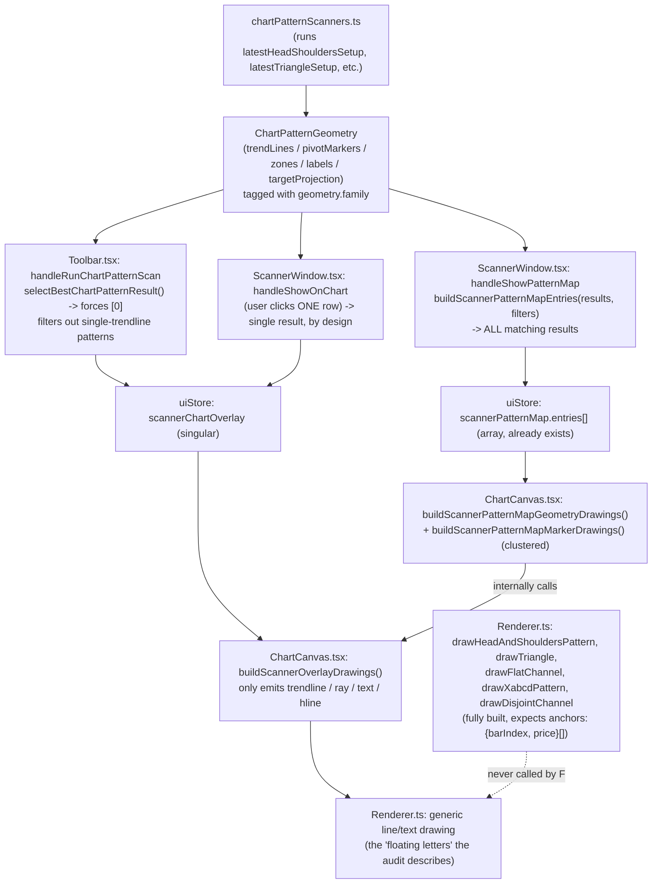

# Chart Pattern Recognition & Full-Chart Overlay — Fix Architecture Guide v1

**Status:** Ready for implementation planning. Supersedes `chart_pattern_deep_audit.md` — this document verifies every claim in that audit against the actual source (`chartPatternScanners.ts`, `chartPatternPrimitives.ts`, `chartPatternTypes.ts`, `Toolbar.tsx`, `ChartCanvas.tsx`, `Renderer.ts`, `ScannerWindow.tsx`, `uiStore.ts`) and corrects scope where the code diverges from the audit's assumptions.

**Files read (all 8, full content):** `chartPatternScanners.ts` (4902 lines), `chartPatternPrimitives.ts` (127 lines), `chartPatternTypes.ts` (141 lines), `Toolbar.tsx` (506 lines), `ChartCanvas.tsx` (2849 lines), `Renderer.ts` (4827 lines), `ScannerWindow.tsx` (2618 lines), `uiStore.ts` (541 lines).

---

## 0. Verification Summary — What Changed From the Original Audit

| # | Original audit claim | Verification result |
|---|---|---|
| 1 | Scanners hardcode `.slice(-60)` etc. | **Confirmed**, but these are named constants (`REVERSAL_LOOKBACK_BARS = 60`, `STRUCTURE_LOOKBACK_BARS = 40`), not scattered literals. Widening is a 2-constant edit, not a find/replace across the file. |
| 2 | `selectBestChartPatternResult` forces `[0]`, drops multi-trendline-only patterns | **Confirmed exactly**, `Toolbar.tsx` L337–351. |
| 3 | `findLocalPivots` latches onto 1–2 bar noise | **Confirmed exactly**, `chartPatternPrimitives.ts` L68–87. |
| 4 | H&S / Triangle / Cup&Handle / Double-Top geometric flaws | **Confirmed exactly** — neckline averaging, index-based slope, no amplitude/duration/volume gates, min pivot spacing is only 3 bars with **no maximum**. |
| 5 | `ChartCanvas.tsx` renders floating letters instead of native multi-anchor renderers | **Confirmed, and now root-caused precisely** (see §2). `Renderer.ts` has fully-built `headAndShouldersPattern`, `triangle`, `flatChannel`, `disjointChannel`, `xabcdPattern` renderers — none are ever invoked by the scanner overlay path. |
| 6 | Phase 3 needs new `scannerChartOverlays: ScannerChartOverlay[]` in `uiStore.ts` | **Not needed — this already exists.** `uiStore.ts` already has `scannerPatternMap: { entries: ScannerPatternMapEntry[], selectedEntryId, showVisibleGeometry }`, and `ChartCanvas.tsx` already renders clustered markers + geometry for every entry in it (see §2, §5). The audit's Phase 3 recommendation would have built a duplicate of infrastructure that's already shipped. |
| — | *(not in original audit)* | **New finding:** `findMultiScalePivots()` (scales `[3,5,10,20]`) and `hasPatternVolumeProfile()` (breakout volume confirmation) are fully implemented in `chartPatternPrimitives.ts` and **never called by any scanner**. This is reusable dead code, not a gap to build from scratch. |
| — | *(not in original audit)* | **New finding:** the geometry → drawing bridge gap is precise and narrow. `ChartPatternGeometry` (generic `trendLines`/`pivotMarkers`/`zones`/`labels`/`targetProjection`) is never translated into the `anchors: {barIndex, price}[]` array the rich `ChartDrawing` kinds require. `buildScannerOverlayDrawings()` in `ChartCanvas.tsx` only ever emits `trendline`/`ray`/`text`/`hline`, regardless of `geometry.family`. This one function is the actual chokepoint — see §5. |

---

## 1. Scope

**In scope:**
- Multi-scale swing pivot engine with real amplitude/ATR filtering (Phase 1)
- Geometric validation rewrite for H&S, triangles, double/triple top-bottom, cup & handle (Phase 2)
- Reactivating `findMultiScalePivots` and `hasPatternVolumeProfile` (currently dead code)
- Fixing the Toolbar.tsx quick-scan action's use of the pattern-map pipeline instead of its own flawed single-result filter (Phase 3, revised)
- Geometry → multi-anchor `ChartDrawing` bridge in `ChartCanvas.tsx` (Phase 4)

**Out of scope:**
- `Renderer.ts` drawing implementations — already correct, not touched
- `ScannerWindow.tsx` UI/UX beyond the data it feeds into the pattern-map pipeline
- New pattern families beyond the 5 the audit covers (H&S, triangles, double/triple top-bottom, cup & handle)
- Live-tick / intraday concerns — unrelated to this workstream (separate open question flagged in the rendering guide)

**Constraint:** preserve existing working behavior. `scannerChartOverlay` (singular) is used elsewhere as a legitimate "jump to and highlight this one clicked result" action (`ScannerWindow.tsx` `handleShowOnChart`) — that mechanism is correct and stays. Only the *Toolbar quick-scan's* use of a forced single "best" result is the bug.

---

## 2. Current State — Verified Data Flow



**Key insight:** the audit's Root Cause 4 is real, but the fix is narrower than "build full-chart multi-overlay architecture." The multi-overlay architecture (§ pattern map) already ships. The actual chokepoint is a single function, `buildScannerOverlayDrawings()`, which every path funnels through and which never dispatches on `geometry.family` to build the `anchors[]` shape the rich renderers expect.

---

## 3. Phase 1 — Macro/Meso Swing Pivot Engine

**File:** `chartPatternPrimitives.ts`

**Current state:** `findMultiScalePivots(bars, scales=[3,5,10,20])` exists but is unused. It still only does neighbor-count comparison at each scale — no price-magnitude or ATR filter, so even at scale 20 it will flag a bar that's merely 1 tick higher than its 20 neighbors. This does not solve the noise problem by itself; it needs a magnitude gate layered on top.

**Proposed addition** — a magnitude filter applied after candidate detection, not a replacement for the multi-scale scan:

```typescript
export interface SwingPivot extends ChartPatternPivot {
  scale: number;
  magnitudePct: number;
}

export function findSwingPivots(
  bars: EodBar[],
  opts: {
    scales?: number[];           // neighbor-comparison window sizes to try
    minMovePct?: number;         // e.g. 5 — minimum % move from the prior confirmed pivot
    atrPeriod?: number;          // if set, use ATR-relative threshold instead of flat %
    atrMultiplier?: number;      // e.g. 2.5
  } = {},
): SwingPivot[] {
  const { scales = [3, 5, 10, 20], minMovePct = 5, atrPeriod, atrMultiplier = 2.5 } = opts;
  const candidates = findMultiScalePivots(bars, scales); // reuse existing function, don't rewrite it
  const confirmed: SwingPivot[] = [];
  let lastConfirmed: ChartPatternPivot | null = null;

  for (const candidate of candidates) {
    const threshold = atrPeriod
      ? (computeAtrAt(bars, candidate.index, atrPeriod) ?? 0) * atrMultiplier
      : (lastConfirmed?.price ?? candidate.price) * (minMovePct / 100);
    if (!lastConfirmed) {
      confirmed.push({ ...candidate, scale: 0, magnitudePct: 0 });
      lastConfirmed = candidate;
      continue;
    }
    const move = Math.abs(candidate.price - lastConfirmed.price);
    if (move < threshold) continue; // still noise relative to last confirmed swing
    if (candidate.kind === lastConfirmed.kind) {
      // same-direction pivot supersedes the prior one if more extreme
      const isMoreExtreme = candidate.kind === 'high'
        ? candidate.price > lastConfirmed.price
        : candidate.price < lastConfirmed.price;
      if (isMoreExtreme) { confirmed[confirmed.length - 1] = { ...candidate, scale: 0, magnitudePct: round((move / lastConfirmed.price) * 100, 2) }; lastConfirmed = candidate; }
      continue;
    }
    confirmed.push({ ...candidate, scale: 0, magnitudePct: round((move / lastConfirmed.price) * 100, 2) });
    lastConfirmed = candidate;
  }
  return confirmed;
}
```

**Open decision (needs your input, not something I should default silently):** flat `minMovePct` vs. ATR-relative threshold. A fixed 5% swing threshold will over-filter low-volatility large-caps and under-filter small-caps. Recommendation: default to ATR-relative (`atrPeriod: 14, atrMultiplier: 2.5`), fall back to `minMovePct` only when fewer than 14 bars of ATR history are available. This mirrors the "null snapshot below 50 bars" pattern already established in `AI_Engine_Prompt_v2.md`.

**Vitest scenarios:**
- Monotonic uptrend, no reversals → 2 pivots (start, end), no intermediate noise pivots
- Small daily wiggles (±1–2%) inside a larger trend → wiggles filtered, only the macro swing points remain
- Known W-bottom fixture (two comparable lows, valid retracement) → exactly the 3 expected pivots survive
- Fewer than `atrPeriod` bars available → falls back to `minMovePct` path without throwing

---

## 4. Phase 2 — Geometric Validation Rewrite

**File:** `chartPatternScanners.ts`. Constants currently at file top: `REVERSAL_LOOKBACK_BARS = 60`, `STRUCTURE_LOOKBACK_BARS = 40`, `LEVEL_TOLERANCE_PCT = 3`.

| Pattern | Current rule (verified) | Proposed rule |
|---|---|---|
| **Head & Shoulders** (`latestHeadShouldersSetup`, L4523–4560) | `head > shoulder * 1.04`; neckline = flat average of 2 troughs; min pivot spacing 3 bars, no max; no prior-trend check; no volume check | Prior uptrend/downtrend ≥15% into left shoulder; head ≥1.05× max(shoulder); shoulder parity ±6% (reuse `pivotsComparable`, new tolerance param instead of shared `LEVEL_TOLERANCE_PCT`); neckline via `linearSlope` across the two troughs at their actual bar indices, not price-average; symmetry ratio `time(LS→H)/time(H→RS)` ∈ [0.4, 2.5]; wire `hasPatternVolumeProfile` for right-shoulder volume fade |
| **Triangles** (`latestTriangleSetup`, L2501–2540) | `linearSlope()` on `pivots.map(p => p.price)` — array index as X, not bar index; only 2 pivots per side minimum implied by slice(-4) | `linearSlope()` must take `{x: barIndex, y: price}` pairs, not raw price array (function signature change — see below); require ≥2 distinct touches per side already present via `countTouches`, add R² ≥0.80 gate; require apex convergence ≥20 bars ahead |
| **Double/Triple Top-Bottom** (`latestComparablePivotSetup`, L2388–2404) | Tolerance ±3% (global `LEVEL_TOLERANCE_PCT`); min spacing 3 bars, no max; no retracement-depth check | Tolerance ±2.5% (pattern-specific, don't reuse the global constant); peak-to-peak spacing ≥15 and ≤120 bars; intervening valley retracement 10–30% of the move — needs a new helper `retracementDepthPct(pivots, bars)` |
| **Cup & Handle** (`latestCupHandleSetup`, L4563–4610) | `slice(-30)`: 25 cup bars (hardcoded via `patternBars.slice(0, -5)`) + 4 handle bars; depth check only on close-to-close, no curvature | `STRUCTURE_LOOKBACK_BARS`-style dedicated constant `CUP_HANDLE_LOOKBACK_BARS ≥ 90` (35+ bar cup minimum per audit's research); depth 12–35% (currently unbounded); handle pullback cap already close (`cupDepth * 0.4` ≈ 40%, spec says ≤33–50%, keep as-is); rounded-bottom curvature score is new — lowest-effort proxy: compare cup's left-half vs right-half average slope magnitude, not a full parabola fit |

**`linearSlope` signature change required** (breaking change, used at 3 call sites — triangle upper rail, triangle lower rail, H&S neckline):

```typescript
// current
export function linearSlope(values: number[]): number | null

// proposed — keep old signature working, add index-aware overload
export function linearSlope(points: Array<{ x: number; y: number }>): number | null {
  if (points.length < 2) return null;
  const n = points.length;
  const sumX = points.reduce((s, p) => s + p.x, 0);
  const sumY = points.reduce((s, p) => s + p.y, 0);
  const sumXY = points.reduce((s, p) => s + p.x * p.y, 0);
  const sumXX = points.reduce((s, p) => s + p.x * p.x, 0);
  const denom = n * sumXX - sumX * sumX;
  return denom === 0 ? null : (n * sumXY - sumX * sumY) / denom;
}
```
All 3 call sites need updating from `linearSlope(pivots.map(p => p.price))` to `linearSlope(pivots.map(p => ({ x: p.index, y: p.price })))`. This is a mechanical, low-risk change once the signature is agreed.

**Open decision — the "≥80% fit" scoring formula:** neither the original audit nor the current code defines this numerically. Recommendation: a weighted rule-based score, not a black-box fit percentage —

```
score = 100 * (
  0.30 * amplitudeCheck +      // prior trend / head height / cup depth, pass=1/fail=0
  0.25 * symmetryCheck +       // shoulder parity, peak tolerance, R²
  0.20 * durationCheck +       // min/max bar spacing satisfied
  0.15 * volumeCheck +         // hasPatternVolumeProfile result
  0.10 * necklineQualityCheck  // slope sanity, no inversion
)
```
This reuses the same tier/suppression philosophy already established in `AI_Engine_Prompt_v2.md` (0–100 integer scale, suppress below a cutoff). Suggest suppression below 60 for chart patterns specifically (stricter than the AI engine's 40, since a badly-shaped chart pattern is visually misleading in a way a low-confidence AI note is not). **This weighting is a starting proposal — confirm before implementation.**

---

## 5. Phase 3 — Overlay Pipeline (Revised Scope)

**Original audit recommendation:** build `scannerChartOverlays: ScannerChartOverlay[]` in `uiStore.ts`, upgrade `Toolbar.tsx` and `ScannerWindow.tsx` to collect all patterns.

**Revised recommendation — do not build new state.** `uiStore.scannerPatternMap` already does this:
- `ScannerWindow.tsx` L192–208: `buildScannerPatternMapEntries(results, scannerDefinitionById, filters)` — already aggregates all matches, with family/direction/priority/status filters
- `ChartCanvas.tsx` L2324–2381: already renders clustered markers (`◆` / `+N`) for all entries, and full geometry for entries in the visible viewport when toggled on

**The actual fix:** `Toolbar.tsx handleRunChartPatternScan` (L66–~105) currently:
1. Runs the scan
2. Calls the flawed `selectBestChartPatternResult` (drops single-trendline patterns, forces `[0]`)
3. Calls singular `showScannerChartOverlay`

**Proposed change:** redirect this action to build and show a pattern map for the current instrument instead of forcing a single result:

```typescript
// Toolbar.tsx handleRunChartPatternScan — replace the bestResult branch
const instrumentEntries = buildScannerPatternMapEntries(
  results.filter((r) => r.exchange === instrument.exchange && r.symbol === instrument.symbol),
  scannerDefinitionById,
  { family: 'all', direction: 'all', priority: 'all', status: 'all' },
);
if (instrumentEntries.length === 0) {
  clearScannerPatternMap();
  addToast(`No chart patterns matched ${instrument.exchange}:${instrument.symbol}.`, 'info', 'Scanner');
  return;
}
showScannerPatternMap(instrumentEntries);
// jump viewport to the most recent match, same as today
const mostRecent = instrumentEntries[instrumentEntries.length - 1];
const barIndex = findBarIndexOnOrAfter(activeTab.displayBars, mostRecent.date);
if (barIndex >= 0) scrollToViewportStart(Math.max(0, barIndex - Math.floor(span / 2)));
```

This removes `isDrawableBoundaryPattern`'s ≥2-trendline filter from this code path entirely — it was only ever a proxy for "is this pattern good enough to be the one-and-only shown result," which stops being necessary once all matches are shown.

**Decision needed from you:** should `Toolbar.tsx`'s quick-scan button and `ScannerWindow.tsx`'s "Show Pattern Map" button converge on identical behavior (one becomes a shortcut for the other), or should the toolbar version stay scoped to only the current instrument while the ScannerWindow version can span a whole watchlist scan? The `buildScannerPatternMapEntries` signature already supports both via its filters — this is a product decision, not a technical constraint.

---

## 6. Phase 4 — Native Multi-Anchor Rendering Bridge

**This is the real fix for the "floating letters" problem**, and it's narrower than the audit's Phase 4 implied.

**File:** `ChartCanvas.tsx`, function `buildScannerOverlayDrawings()` (starts L2043). **Confirmed:** this function is the single chokepoint both the Toolbar path and the Pattern Map path funnel through — `buildScannerPatternMapGeometryDrawings` (L2352) calls `buildScannerOverlayDrawings` internally per entry. Fixing this one function fixes rendering for both.

**Confirmed renderer contract** (`Renderer.ts` L1636–1642, `toMultiAnchorPixels`):
```typescript
// drawing.anchors must be: { barIndex: number; price: number }[]
```
`drawHeadAndShouldersPattern` (L2445) expects anchors in order `[LS, N1, Head, N2, RS, Target, Stop]` (7 points, labels hardcoded at L2452). Similarly `triangle`, `flatChannel`, `disjointChannel`, `xabcdPattern` each expect their own anchor ordering — needs a read of each renderer's label array before wiring (not fully enumerated in this pass; flagged as a Phase 4 sub-task).

**Proposed bridge function:**

```typescript
function geometryToMultiAnchorDrawing(
  entry: { id: string; geometry?: ChartPatternGeometry },
  bars: OHLCBar[],
): ChartDrawing | null {
  const geometry = entry.geometry;
  if (!geometry) return null;

  const anchorFromPoint = (p: ChartPatternGeometryPoint): { barIndex: number; price: number } | null => {
    const idx = findBarIndexOnOrAfter(bars, p.date);
    return idx < 0 ? null : { barIndex: idx, price: p.price };
  };

  switch (geometry.family) {
    case 'head-and-shoulders':
    case 'complex-head-and-shoulders': {
      const ls = geometry.pivotMarkers?.find((p) => p.label === 'LS');
      const n1 = geometry.trendLines?.find((t) => t.role === 'neckline')?.start;
      const head = geometry.pivotMarkers?.find((p) => p.label === 'Head');
      const n2 = geometry.trendLines?.find((t) => t.role === 'neckline')?.end;
      const rs = geometry.pivotMarkers?.find((p) => p.label === 'RS');
      const points = [ls, n1, head, n2, rs].filter(Boolean).map((p) => anchorFromPoint(p as ChartPatternGeometryPoint));
      if (points.some((p) => p === null) || points.length < 5) return null;
      const anchors = points as { barIndex: number; price: number }[];
      if (geometry.targetProjection) {
        const tgtIdx = anchors[anchors.length - 1].barIndex;
        anchors.push({ barIndex: tgtIdx, price: geometry.targetProjection.targetPrice });
        anchors.push({ barIndex: tgtIdx, price: geometry.targetProjection.stopLossPrice });
      }
      return { id: `${entry.id}:hs-geometry`, kind: 'headAndShouldersPattern', anchors, color: getScannerOverlayColor(undefined), locked: true } as ChartDrawing;
    }
    // 'triangle', 'wedge' -> kind: 'triangle'; 'channel' -> 'flatChannel' or 'disjointChannel'; etc.
    // Each needs its renderer's expected anchor order confirmed against Renderer.ts before wiring.
    default:
      return null; // falls through to the existing generic trendline rendering — safe fallback
  }
}
```

**Why `pivotMarkers` need a stable `label` field:** the scanners currently label markers with free text (need to verify against actual `latestHeadShouldersSetup` output — the setup function returns `leftShoulder`/`head`/`rightShoulder` objects, but the code that turns these into `ChartPatternGeometryPivotMarker[]` with `label: 'LS'/'Head'/'RS'` was not in the excerpt reviewed; **flag: locate the geometry-building step in `chartPatternScanners.ts` that constructs `ChartPatternResultDetails.geometry` from the setup functions' output before finalizing this bridge** — it's downstream of the setup functions shown in §4 and wasn't part of this file pass.

**Coverage gap to flag explicitly:** `ChartPatternGeometryFamily` has 24 values; `Renderer.ts` has 5 dedicated multi-anchor renderers (`headAndShouldersPattern`, `triangle`, `flatChannel`, `disjointChannel`, `xabcdPattern`). Patterns without a dedicated renderer (double/triple top-bottom, cup & handle, flags, wedges beyond triangle-shaped ones, etc.) fall through to the existing generic trendline/zone rendering — which is fine for zone-based patterns (cup & handle can use `zones` + a target line reasonably well) but is a real gap for anything needing a distinctive shape.

**Decision needed from you:** which families get a dedicated `Renderer.ts` shape next, in priority order? Recommendation based on the audit's own findings: triangles (renderer already exists, just needs wiring) and H&S (renderer already exists, needs wiring) first since zero new `Renderer.ts` code is needed — double/triple top-bottom and cup & handle would need new renderer functions if you want them to look distinct beyond generic trendlines+zones.

---

## 7. Testing Strategy (Vitest)

Following the existing project pattern (see `AI_Engine_Prompt_v2.md`'s 6 named edge cases):

| Phase | Scenario | Assertion |
|---|---|---|
| 1 | Flat/sideways market, no real swings | `findSwingPivots` returns 0 or 1 pivots, not dozens of noise points |
| 1 | Fewer than `atrPeriod` bars | Falls back to `minMovePct`, doesn't throw |
| 2 | Known historical H&S (fixture from a real prior instance) | Detected, score ≥ suppression cutoff |
| 2 | Near-H&S but shoulders 15% apart (fails parity) | Not detected |
| 2 | Double top with valley retracement of 5% (below 10% floor) | Not detected — currently WOULD be detected (regression guard) |
| 2 | Cup & handle with only 20-bar cup (below new minimum) | Not detected — currently WOULD be detected at `bars.length >= 18` (regression guard) |
| 3 | Instrument with 3 separate historical H&S instances | All 3 appear as pattern-map entries, none dropped by `isDrawableBoundaryPattern` |
| 4 | H&S geometry with all 5 pivot markers + neckline present | Bridge produces a valid `headAndShouldersPattern` anchors array, no null anchors |
| 4 | Geometry family with no dedicated renderer | Falls through to generic trendline rendering, doesn't crash |

---

## 8. Risk Table

| Risk | Phase | Mitigation |
|---|---|---|
| Widening lookback from 60/40 bars to 500+ increases scan cost per symbol | 1, 2 | EOD bars only (per platform scope), typical instrument history is a few thousand bars max — synchronous scan should stay well under 100ms; profile before assuming a worker is needed (separate from the rendering engine's OffscreenCanvas/Worker question, which is about the canvas paint loop, not scanning) |
| `linearSlope` signature change breaks 3 existing call sites silently if missed | 2 | Grep for all `linearSlope(` call sites before merging; TypeScript will catch shape mismatches if the array-of-numbers overload is removed rather than kept |
| Retiring `isDrawableBoundaryPattern` filter from Toolbar path changes user-visible behavior (more patterns now show) | 3 | This is an intended behavior change per the audit's goal — flag to end users as "chart pattern scan now shows all matches, not just one," not a silent change |
| Geometry → anchors bridge silently returns `null` for malformed geometry (missing dates that don't resolve to a bar index) | 4 | `findBarIndexOnOrAfter` returning `-1` is already handled defensively elsewhere in `ChartCanvas.tsx` (see `buildScannerOverlayDrawings`'s existing `startIndex < 0` guards) — follow the same pattern |
| Scoring formula (§4) is a proposal, not validated against real data | 2 | Needs backtesting against a labeled fixture set before trusting the 80%/60% cutoffs in production |

---

## 9. Open Decisions (need your input before implementation)

1. **ZigZag threshold method** — fixed `minMovePct` vs. ATR-relative vs. hybrid (§3)
2. **Scoring formula weights** for the ≥80%/suppression-60 fidelity gate (§4) — proposal given, not validated
3. **Toolbar quick-scan vs. ScannerWindow pattern map** — converge into one action, or keep scoped differently (single-instrument quick view vs. multi-instrument watchlist scan)? (§5)
4. **Renderer priority order** for the 19 pattern families without a dedicated `Renderer.ts` shape (§6) — triangles and H&S are zero-new-renderer-code; everything else needs new `Renderer.ts` functions if distinct shapes are wanted
5. **Where `ChartPatternResultDetails.geometry` is actually constructed** from the setup functions in `chartPatternScanners.ts` — not located in this pass (the setup functions shown in §4 return raw shoulder/pivot data, not yet in `ChartPatternGeometry` shape). Needs a follow-up read before Phase 4 anchor-mapping can be finalized with certainty.

---

## 10. Files to Be Touched (summary)

| File | Phase(s) | Nature of change |
|---|---|---|
| `chartPatternPrimitives.ts` | 1 | Add `findSwingPivots`, `computeAtrAt`; change `linearSlope` to accept `{x,y}[]` |
| `chartPatternScanners.ts` | 1, 2 | Rewrite 4 setup functions' validation logic; wire in `hasPatternVolumeProfile`; update 3 `linearSlope` call sites; widen/rename lookback constants |
| `Toolbar.tsx` | 3 | Replace `handleRunChartPatternScan`'s best-result branch with pattern-map population |
| `ChartCanvas.tsx` | 4 | Add `geometryToMultiAnchorDrawing`, call it from `buildScannerOverlayDrawings` before falling back to generic trendline rendering |
| `uiStore.ts` | — | **No changes needed** — existing `scannerPatternMap` state already covers Phase 3 |
| `Renderer.ts` | 4 (future) | Only if new dedicated shapes are approved per open decision #4 — no changes required for triangle/H&S wiring |
