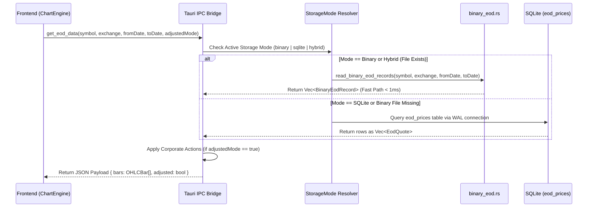

# Data Engine & Storage Architectures

## 1. High-Performance `.eod` Binary File Format (Version 1)

To achieve sub-millisecond historical chart loading across decades of daily price history for 8,500+ Indian equities and indices, the platform utilizes a custom, fixed-record direct-mapped binary format (`.eod`).

### 1.1 Header Structure (128 Bytes Fixed)

Every `.eod` file begins with an immutable 128-byte header storing file metadata, versioning, symbol context, and pricing scale factors.

| Offset (Bytes) | Field Name | Data Type | Endianness | Description |
|---|---|---|---|---|
| `0x00 .. 0x03` | `magic` | `[u8; 4]` | N/A | Magic signature string: `ASCII "EOD1"` (`0x45 0x4F 0x44 0x31`) |
| `0x04 .. 0x05` | `version` | `u16` | Little-Endian | Format version (Current = `1`) |
| `0x06 .. 0x07` | `record_size` | `u16` | Little-Endian | Size in bytes per record (Always `64`) |
| `0x08 .. 0x0B` | `record_count` | `u32` | Little-Endian | Total number of 64-byte records in the file |
| `0x0C .. 0x0F` | `price_scale` | `u32` | Little-Endian | Fixed-point scale factor (Default = `10000` / 4 decimal places) |
| `0x10 .. 0x2F` | `symbol` | `[u8; 32]` | ASCII/UTF-8 | Ticker symbol string, null-padded |
| `0x30 .. 0x3F` | `exchange` | `[u8; 16]` | ASCII/UTF-8 | Exchange identifier (`"NSE"`, `"BSE"`), null-padded |
| `0x40 .. 0x7F` | `reserved` | `[u8; 64]` | Zero-filled | Reserved for future expansion (e.g. corporate action flags, split counters) |

```
 0                   1                   2                   3
 0 1 2 3 4 5 6 7 8 9 0 1 2 3 4 5 6 7 8 9 0 1 2 3 4 5 6 7 8 9 0 1
+-+-+-+-+-+-+-+-+-+-+-+-+-+-+-+-+-+-+-+-+-+-+-+-+-+-+-+-+-+-+-+-+
|       Magic "EOD1"            |  Version (1)  | RecordSz (64) |
+-+-+-+-+-+-+-+-+-+-+-+-+-+-+-+-+-+-+-+-+-+-+-+-+-+-+-+-+-+-+-+-+
|        Record Count           |         Price Scale           |
+-+-+-+-+-+-+-+-+-+-+-+-+-+-+-+-+-+-+-+-+-+-+-+-+-+-+-+-+-+-+-+-+
|                                                               |
+                    Symbol (32 bytes UTF-8)                    +
|                                                               |
+-+-+-+-+-+-+-+-+-+-+-+-+-+-+-+-+-+-+-+-+-+-+-+-+-+-+-+-+-+-+-+-+
|                    Exchange (16 bytes UTF-8)                  |
+-+-+-+-+-+-+-+-+-+-+-+-+-+-+-+-+-+-+-+-+-+-+-+-+-+-+-+-+-+-+-+-+
|                                                               |
+                    Reserved (64 bytes Zeroes)                 +
|                                                               |
+-+-+-+-+-+-+-+-+-+-+-+-+-+-+-+-+-+-+-+-+-+-+-+-+-+-+-+-+-+-+-+-+
```

---

### 1.2 Price Record Structure (64 Bytes Fixed)

Records are stored sequentially immediately following byte offset `128`. Records are strictly ordered by date ascending (`YYYYMMDD`).

| Offset (Bytes) | Field Name | Data Type | Endianness | Scaling / Format |
|---|---|---|---|---|
| `0x00 .. 0x03` | `date` | `u32` | Little-Endian | Date formatted as integer: `YYYYMMDD` (e.g., `20260816`) |
| `0x04 .. 0x07` | `flags` | `u32` | Little-Endian | Bit 0: Corporate action split/bonus applied; Bit 1: Dividend; Bit 2: Suspended |
| `0x08 .. 0x0F` | `open` | `i64` | Little-Endian | Scaled price: `raw_value = (price * price_scale)` |
| `0x10 .. 0x17` | `high` | `i64` | Little-Endian | Scaled price: `raw_value = (price * price_scale)` |
| `0x18 .. 0x1F` | `low` | `i64` | Little-Endian | Scaled price: `raw_value = (price * price_scale)` |
| `0x20 .. 0x27` | `close` | `i64` | Little-Endian | Scaled price: `raw_value = (price * price_scale)` |
| `0x28 .. 0x2F` | `prev_close` | `i64` | Little-Endian | Scaled price: `raw_value = (price * price_scale)` |
| `0x30 .. 0x37` | `volume` | `u64` | Little-Endian | Traded share volume quantity |
| `0x38 .. 0x3F` | `open_interest`| `u64` | Little-Endian | Open Interest contract quantity (for derivatives/index feeds) |

### 1.3 Memory Alignment & Math Benefits
* **Direct Offset Calculation**: To access bar `i`, seek directly to offset `128 + (i * 64)`.
* **Zero-Allocation Binary Search**: Range filtering (`from_date` to `to_date`) uses an $O(\log N)$ in-place binary seek on disk without loading unneeded bars into memory.
* **Exact Integer Scaling**: Using 64-bit integers with a `10,000` scale factor completely eliminates IEEE-754 floating-point rounding errors on currency values (e.g. ₹124.55 is stored as `1245500`).

---

## 2. SQLite Database Schema & PRAGMA Architecture

The SQLite database (`market-data.sqlite3`) acts as the relational metadata index, catalog registry, settings store, and corporate action journal.

### 2.1 Connection Pragmas
Upon connection acquisition, `src-tauri-shell/src/database/bootstrap.rs` executes optimized performance pragmas:

```sql
PRAGMA busy_timeout = 15000;          -- 15-second busy timeout to prevent write locks
PRAGMA journal_mode = WAL;            -- Write-Ahead Logging for concurrent readers + writer
PRAGMA synchronous = NORMAL;         -- Balances durability with write throughput in WAL mode
PRAGMA cache_size = -64000;           -- 64MB dedicated page cache in RAM
PRAGMA temp_store = MEMORY;           -- Temporary tables & indices held entirely in RAM
PRAGMA mmap_size = 268435456;         -- 256MB memory-mapped I/O for direct kernel page mapping
PRAGMA foreign_keys = ON;             -- Strict relational integrity enforcement
```

---

### 2.2 Core Table Schemas & Indexes

#### 1. Instruments (`instruments`)
Stores canonical security identities across NSE and BSE.
```sql
CREATE TABLE IF NOT EXISTS instruments (
  symbol TEXT NOT NULL,
  exchange TEXT NOT NULL DEFAULT 'NSE',
  bse_security_code TEXT,
  isin TEXT,
  name TEXT,
  series TEXT,
  series_as_of_date TEXT,
  sector TEXT,
  industry TEXT,
  is_active INTEGER NOT NULL DEFAULT 1,
  lifecycle_status TEXT NOT NULL DEFAULT 'CURRENT',
  updated_at TEXT NOT NULL DEFAULT (datetime('now')),
  PRIMARY KEY (symbol, exchange)
);

CREATE INDEX IF NOT EXISTS idx_instruments_isin ON instruments(isin);
CREATE INDEX IF NOT EXISTS idx_instruments_bse_code ON instruments(bse_security_code);
CREATE INDEX IF NOT EXISTS idx_instruments_exchange_active ON instruments(exchange, is_active);
CREATE INDEX IF NOT EXISTS idx_instruments_series ON instruments(exchange, series);
```

#### 2. Relational EOD Prices (`eod_prices`)
Used in SQLite or Hybrid storage modes; serves as fallback or primary data store.
```sql
CREATE TABLE IF NOT EXISTS eod_prices (
  symbol TEXT NOT NULL,
  exchange TEXT NOT NULL DEFAULT 'NSE',
  date TEXT NOT NULL,
  open REAL NOT NULL,
  high REAL NOT NULL,
  low REAL NOT NULL,
  close REAL NOT NULL,
  prev_close REAL,
  volume INTEGER NOT NULL DEFAULT 0,
  open_interest INTEGER NOT NULL DEFAULT 0,
  trades INTEGER,
  delivery_qty INTEGER,
  delivery_pct REAL,
  PRIMARY KEY (symbol, exchange, date)
);

CREATE INDEX IF NOT EXISTS idx_eod_prices_date ON eod_prices(date);
CREATE INDEX IF NOT EXISTS idx_eod_prices_lookup ON eod_prices(exchange, symbol, date);
```

#### 3. Corporate Action Audit & Reconciliation Engine
```sql
CREATE TABLE IF NOT EXISTS corporate_actions (
  id INTEGER PRIMARY KEY AUTOINCREMENT,
  symbol TEXT NOT NULL,
  exchange TEXT NOT NULL DEFAULT 'NSE',
  effective_date TEXT NOT NULL,
  action_type TEXT NOT NULL,
  factor REAL NOT NULL,
  adjust_volume INTEGER NOT NULL DEFAULT 1,
  note TEXT,
  applied_at TEXT NOT NULL DEFAULT (datetime('now')),
  UNIQUE (symbol, exchange, effective_date, action_type, factor)
);

CREATE TABLE IF NOT EXISTS corporate_action_imports (
  id INTEGER PRIMARY KEY AUTOINCREMENT,
  dedupe_key TEXT NOT NULL UNIQUE,
  exchange TEXT NOT NULL DEFAULT 'NSE',
  source TEXT NOT NULL,
  source_file TEXT,
  symbol TEXT,
  isin TEXT,
  bse_scrip_code TEXT,
  company_name TEXT,
  purpose_raw TEXT NOT NULL,
  ex_date TEXT,
  record_date TEXT,
  action_type TEXT NOT NULL DEFAULT 'OTHER',
  ratio_num REAL,
  ratio_den REAL,
  old_face_value REAL,
  new_face_value REAL,
  cash_amount REAL,
  factor REAL,
  price_factor REAL,
  parse_status TEXT NOT NULL DEFAULT 'NEEDS_REVIEW',
  review_status TEXT NOT NULL DEFAULT 'PENDING',
  message TEXT,
  approved_corporate_action_id INTEGER REFERENCES corporate_actions(id),
  imported_at TEXT NOT NULL DEFAULT (datetime('now')),
  approved_at TEXT
);
```

---

## 3. In-Memory Data Structures & Retrieval Pipeline

### 3.1 Retrieval Pipeline (Hybrid Storage Resolution)
When `get_eod_data` is called via Tauri IPC, the backend executes the following resolution strategy:



### 3.2 In-Memory Prev Close Recalculation
To guarantee chart integrity when individual quotes are inserted, edited, or deleted:
1. `quotes.rs:recompute_prev_close_for_symbol` iterates through all chronological records.
2. For each bar $t$, sets $\text{prev\_close}_t = \text{close}_{t-1}$.
3. Synchronizes changes to both SQLite and binary `.eod` storage in a single atomic operation.
