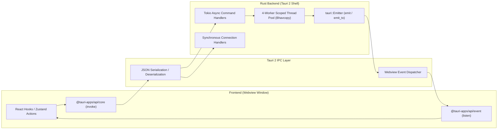

# IPC Architecture, Command Registry & Event Streaming

## 1. Tauri 2 Inter-Process Communication (IPC) Topology

Communication between the React/TypeScript frontend and native Rust core runs across Tauri 2's secure binary bridge.



---

## 2. Exhaustive Tauri Command Registry

All commands are declared in `src-tauri-shell/src/main.rs` and bound to frontend methods in `src/platform/tauriDesktop.ts`.

### 2.1 System, Runtime & Profile Management

| Command | Input Parameters | Return Type | Execution | Purpose |
|---|---|---|---|---|
| `get_app_info` | None | `RuntimeAppInfo` | Sync | Returns executable path, version, build profile, and directory locations |
| `get_price_storage_mode` | None | `String` (`"binary"` \| `"sqlite"` \| `"hybrid"`) | Sync | Retrieves active storage backend mode |
| `get_app_profile_settings` | None | `AppProfileSettings` | Sync | Returns user profile paths and active workspace root |
| `save_app_profile_settings` | `input: AppProfileSettings` | `AppProfileSettings` | Sync | Persists updated profile locations |
| `pick_app_profile_directory` | None | `Option<String>` | Async | Opens native OS dialog to select new profile folder |
| `open_external` | `url: String` | `Result<OperationResult, String>` | Async | Safely opens web link in system default browser |

---

### 2.2 Market Data & Chart Hydration

| Command | Input Parameters | Return Type | Execution | Purpose |
|---|---|---|---|---|
| `get_eod_data` | `input: EodDataRequest` (`symbol`, `exchange`, `fromDate`, `toDate`, `adjustedMode`) | `EodDataResponse` (`bars`, `adjusted`, `corporateActions`) | Async | Retrieves historical OHLCV data with optional split/bonus adjustment |
| `search_symbols` | `query: String`, `exchange: Option<String>`, `limit: Option<u32>` | `Vec<InstrumentSummary>` | Async | Executes high-speed prefix search against local database |
| `list_symbols` | `exchange: Option<String>`, `limit: Option<u32>` | `Vec<InstrumentSummary>` | Async | Returns sorted listing of all registered instruments |
| `get_daily_market_snapshot` | `tradeDate: String`, `exchange: String` | `DailyMarketSnapshotResult` | Async | Fetches bulk single-day quotes for high-speed pattern screener |
| `cancel_daily_market_snapshot`| `jobId: String` | `OperationResult` | Sync | Cancels in-flight market scanner calculation task |

---

### 2.3 Binary File Maintenance & Parity Verification

| Command | Input Parameters | Return Type | Execution | Purpose |
|---|---|---|---|---|
| `get_binary_eod_status` | `symbol: String`, `exchange: String` | `BinaryEodStatus` | Sync | Inspects `.eod` header, record count, and file size on disk |
| `validate_binary_parity` | `exchange: Option<String>` | `ValidationReport` | Async | Cross-checks record count and date ranges between SQLite and `.eod` binary |
| `migrate_to_binary_eod` | `overwrite: bool`, `exchange: Option<String>` | `MigrationReport` | Async | Migrates historical quotes from SQLite table into `.eod` binary format |

---

### 2.4 Bhavcopy Ingestion Engine

| Command | Input Parameters | Return Type | Execution | Purpose |
|---|---|---|---|---|
| `download_bhavcopy` | `date: String`, `exchange: String`, `options: BhavcopyOptions` | `BhavcopyResult` | Async (Tokio) | Downloads, unzips, parses, and ingests single-day official exchange Bhavcopy |
| `download_bhavcopy_batch` | `fromDate: String`, `toDate: String`, `exchange: String` | `BhavcopyBatchResult` | Async (Tokio) | Ingests date range across parallel worker threads with ACID checkpointing |
| `get_bhavcopy_settings` | None | `BhavcopySettings` | Sync | Retrieves configured download URLs and retry policies |
| `save_bhavcopy_settings` | `settings: BhavcopySettings` | `OperationResult` | Sync | Persists updated Bhavcopy source templates |
| `list_market_holidays` | None | `Vec<MarketHoliday>` | Sync | Retrieves calendar holidays to avoid invalid network probes |

---

### 2.5 Corporate Actions & Identity Resolution

| Command | Input Parameters | Return Type | Execution | Purpose |
|---|---|---|---|---|
| `import_corporate_actions_csv`| `filePath: String` | `CorporateActionImportReport` | Async | Ingests historical splits, bonuses, dividends CSV for review |
| `fetch_official_corporate_actions`| `fromDate: String`, `toDate: String` | `CorporateActionFetchReport` | Async | Scrapes official NSE/BSE corporate action announcements |
| `list_corporate_action_imports`| `filter: Option<String>` | `Vec<CorporateActionImportRow>` | Sync | Lists pending, approved, and rejected corporate action events |
| `approve_corporate_action_import`| `id: i64`, `factor: f64` | `OperationResult` | Async | Approves corporate action and applies back-adjusted price factors |
| `apply_corporate_action` | `input: ApplyCorporateActionInput` | `OperationResult` | Async | Manually applies split/bonus ratio to instrument history |
| `merge_symbols` | `sourceSymbol: String`, `targetSymbol: String` | `OperationResult` | Async | Merges historical price records when a company changes ticker symbol |

---

### 2.6 Watchlist Management

| Command | Input Parameters | Return Type | Execution | Purpose |
|---|---|---|---|---|
| `get_watchlists` | None | `Vec<Watchlist>` | Sync | Retrieves all custom and source-linked user watchlists |
| `create_watchlist` | `name: String` | `Watchlist` | Sync | Creates empty user watchlist |
| `delete_watchlist` | `id: i64` | `OperationResult` | Sync | Deletes watchlist and associated item links |
| `add_to_watchlist` | `watchlistId: i64`, `symbol: String`, `exchange: String` | `OperationResult` | Sync | Adds security to watchlist |
| `remove_from_watchlist` | `watchlistId: i64`, `symbol: String`, `exchange: String` | `OperationResult` | Sync | Removes security from watchlist |
| `fetch_official_watchlist_source`| `url: String` | `String` | Async | Backend proxy fetching official NSE/BSE CSV/HTML constituent feeds |

---

## 3. Event Streaming Specifications

The Rust backend streams long-running task progress, diagnostic logs, and menu interactions directly to Webview listeners using `tauri::Emitter`.

### 3.1 Streaming Event Topics & Payload Definitions

#### 1. `bhavcopy:progress`
Emitted during single-day and multi-day Bhavcopy downloads and binary ingestion.
```typescript
interface BhavcopyProgressPayload {
  phase: 'downloading' | 'extracting' | 'parsing' | 'writing_binary' | 'checkpointing';
  currentDate: string;        // "YYYY-MM-DD"
  processedDates: number;
  totalDates: number;
  processedSymbols: number;
  totalSymbols: number;
  percent: number;            // 0 - 100
  message: string;
}
```

#### 2. `bhavcopy:log`
Streams real-time line-by-line ingestion log messages to the Bhavcopy Manager UI console.
```typescript
interface BhavcopyLogPayload {
  level: 'info' | 'warn' | 'error';
  timestamp: string;          // ISO-8601 UTC
  message: string;
}
```

#### 3. `quote-delete:progress`
Emitted during bulk quote deletions (e.g. date range purge or symbol resets).
```typescript
interface QuoteDeleteProgressPayload {
  processedFiles: number;
  totalFiles: number;
  currentSymbol: string | null;
  percent: number;            // 0 - 100
  message: string;
}
```

#### 4. `menu:action`
Dispatched from native Windows application menus to trigger frontend modals and layout switches.
```typescript
interface MenuActionPayload {
  action: 'menu:newChart' | 'menu:saveLayout' | 'menu:openBhavcopy' | 'menu:openScanner' | 'menu:openAlerts';
}
```

---

## 4. Threading & Concurrency Architecture

### 4.1 Worker Model & Storage Durability Rules
1. **Binary Write Worker Cap (4 Workers)**:
   * During bulk Bhavcopy imports, binary `.eod` file updates are dispatched across a scoped thread pool strictly capped at **4 concurrent workers**.
   * *Rationale*: Prevents OS file system lock contention, disk queue saturation, and thread starvation on consumer NVMe/SSD storage.
2. **ACID Recovery Journaling (`bhavcopy_recovery.rs`)**:
   * Multi-day imports write to a staging `.manifest` and `.journal` before touching `.eod` binary files.
   * In the event of a power loss or crash, interrupted sessions in `APPLIED` or `CHECKPOINTING` state automatically resume and verify binary parity upon restart.
3. **Database WAL Isolation**:
   * SQLite operates in Write-Ahead Logging mode (`WAL`), allowing concurrent background read queries (e.g., Symbol Search, Watchlist lookup) while write transactions are active.
