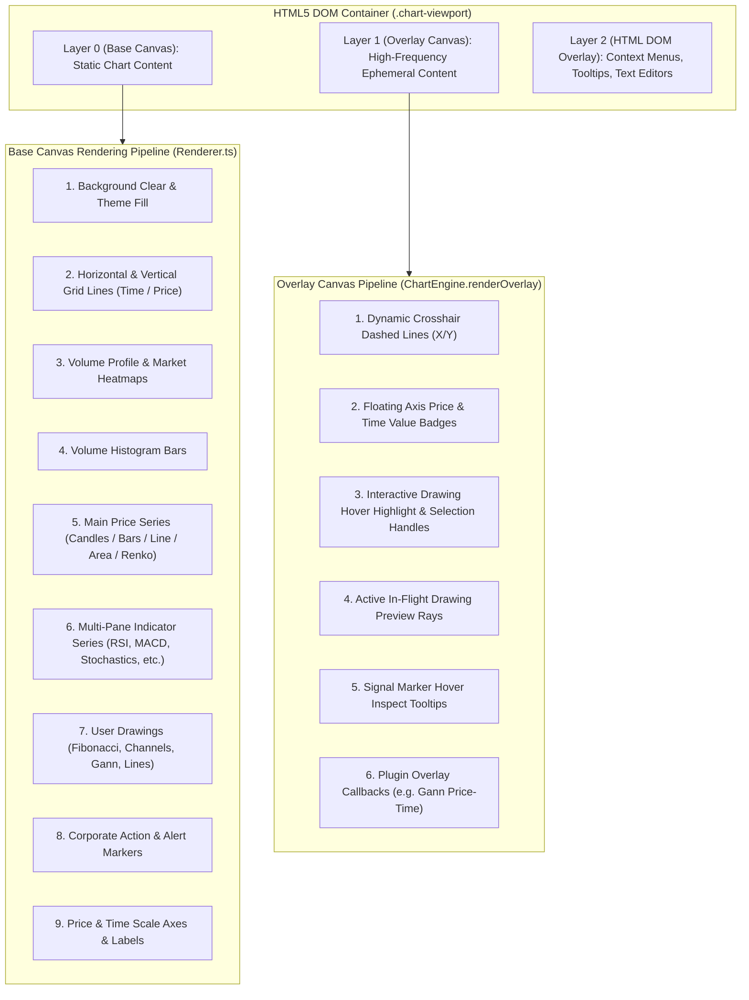

# Canvas 2D Rendering Engine & Coordinate Geometry

## 1. Dual-Canvas Viewport Architecture

To sustain smooth 60+ FPS panning, zooming, indicator recalculation, and interactive drawing creation on complex multi-pane charts containing tens of thousands of data points, the platform employs a **Dual-Layer Canvas Architecture**.



### Performance Separation Rationale
* **Base Canvas (Layer 0)**: Redrawn **only** when data updates, viewport shifts (pan/zoom), indicators change, or drawing geometry is committed.
* **Overlay Canvas (Layer 1)**: Redrawn **on every mouse move event**. Because base price series and heavy indicators are not re-rasterized during pointer motion, CPU and GPU frame times remain under **1.2 milliseconds**.

---

## 2. Exact Coordinate Transformation Mathematics

All coordinate transformations are centralized inside `src/engine/ScaleManager.ts`.

### 2.1 Horizontal (Time-to-X and X-to-Index) Transformations

The horizontal axis operates in **Slot / Index Space** rather than linear timestamp space. This eliminates artificial weekend, holiday, and non-trading session gaps.

Let:
* $W$ = Usable canvas width in device pixels
* $G$ = Left gutter padding (Fixed at `8px`)
* $i_{\text{start}}$ = `viewport.startIndex` (Floating point bar index at left boundary)
* $i_{\text{end}}$ = `viewport.endIndex` (Floating point bar index at right boundary)
* $N_{\text{vis}} = \max(i_{\text{end}} - i_{\text{start}}, 1)$ (Number of visible bar slots)

#### Bar Dimensions:
$$\text{barWidth} = \frac{W - G}{N_{\text{vis}}}$$
$$\text{barGap} = \begin{cases} \max(\text{barWidth} \times 0.10, 1), & \text{if } \text{barWidth} \ge 3 \\ 0, & \text{otherwise} \end{cases}$$
$$\text{bodyWidth} = \max(\text{barWidth} - 2 \times \text{barGap}, \min(\text{barWidth}, 1))$$

#### Coordinate Formulas:
$$\text{Index to Pixel } X(i) = G + (i - i_{\text{start}} + 0.5) \times \text{barWidth}$$
$$\text{Pixel to Index } i(X) = \frac{X - G}{\text{barWidth}} + i_{\text{start}} - 0.5$$

---

### 2.2 Vertical (Price-to-Y and Y-to-Price) Transformations

Let $H$ = Pane height in device pixels, $P_{\text{min}}$ = Padded Minimum Price, $P_{\text{max}}$ = Padded Maximum Price, $\Delta P = P_{\text{max}} - P_{\text{min}}$.

#### 1. Linear Price Scale:
$$\text{Ratio}(P) = \frac{P - P_{\text{min}}}{\Delta P}$$

$$\text{Price to Pixel } Y(P) = \begin{cases} \text{Ratio}(P) \times H, & \text{if inverted} \\ H - (\text{Ratio}(P) \times H), & \text{standard (higher price at top)} \end{cases}$$

$$\text{Pixel to Price } P(Y) = \begin{cases} P_{\text{min}} + \left(\frac{Y}{H}\right) \times \Delta P, & \text{if inverted} \\ P_{\text{min}} + \left(\frac{H - Y}{H}\right) \times \Delta P, & \text{standard} \end{cases}$$

#### 2. Logarithmic Price Scale ($\log(P)$):
$$\text{Let } L_{\text{min}} = \ln(P_{\text{min}}), \quad L_{\text{max}} = \ln(P_{\text{max}}), \quad \Delta L = L_{\text{max}} - L_{\text{min}}$$

$$\text{Log Ratio}(P) = \frac{\ln(P) - L_{\text{min}}}{\Delta L}$$

$$\text{Price to Pixel } Y_{\text{log}}(P) = \begin{cases} \text{Log Ratio}(P) \times H, & \text{if inverted} \\ H - (\text{Log Ratio}(P) \times H), & \text{standard} \end{cases}$$

$$\text{Pixel to Price } P_{\text{log}}(Y) = \begin{cases} \exp\left(L_{\text{min}} + \left(\frac{Y}{H}\right) \times \Delta L\right), & \text{if inverted} \\ \exp\left(L_{\text{min}} + \left(\frac{H - Y}{H}\right) \times \Delta L\right), & \text{standard} \end{cases}$$

---

## 3. High-DPI Display Scaling & Anti-Aliasing

On Retina and 4K displays with fractional device pixel ratios (e.g. 1.25x, 1.5x, 2.0x), standard canvas elements appear blurry.

`src/components/ChartCanvas.tsx` applies hardware-accelerated HiDPI scaling:

```typescript
const dpr = window.devicePixelRatio || 1;
const width = container.clientWidth;
const height = container.clientHeight;

// Set physical drawing buffer size
canvas.width = Math.round(width * dpr);
canvas.height = Math.round(height * dpr);

// Set CSS layout size
canvas.style.width = `${width}px`;
canvas.style.height = `${height}px`;

// Scale canvas context to match virtual coordinates
ctx.scale(dpr, dpr);
```

### Subpixel Pixel Snapping
To prevent 1px gridlines, axes, and candlestick wicks from rendering as blurry 2px anti-aliased lines:
```typescript
// Grid & Line Coordinate Alignment
const crispX = Math.round(rawX) + 0.5;
const crispY = Math.round(rawY) + 0.5;
ctx.moveTo(crispX, crispY);
```

---

## 4. Frame-Rate Optimization Strategies

1. **RequestAnimationFrame (rAF) Batching**:
   * Viewport pan and zoom operations never trigger direct synchronous DOM updates.
   * Updates schedule a singular `requestAnimationFrame` render pass, coalescing multiple wheel/drag events within a 16.6ms frame budget.
2. **Viewport Culling (Clipping Bounds)**:
   * Bars, volume histograms, indicator lines, and drawings outside the visible index range $[i_{\text{start}} - 2, i_{\text{end}} + 2]$ are skipped entirely before rasterization.
3. **Data Conflation (LOD Downsampling)**:
   * When displaying 10+ years of daily data (3,000+ bars) on a 1920px screen, `DataConflation.ts` combines multiple adjacent bars into single representative multi-bar min/max candles, reducing draw calls by up to **80%**.

---

## 5. Plugin Overlay Extension Seam

Analysis plugins that need to draw on the chart surface register a callback via `ChartEngine.setGannOverlayCallback()` rather than accessing the canvas directly. The callback fires at the **end of every `renderOverlay()` frame**, inside the `leftAxisWidth` translate transform, before the final `ctx.restore()`.

### Coordinate Mapper Contract

```typescript
interface GannCoordinateMapper {
  timeToX(barIndex: number): number;  // wraps scaleX.toPixel(barIndex)
  priceToY(price: number): number;    // wraps priceScaleY.toPixel(price)
}
```

`scaleX` and `priceScaleY` are the same `ScaleX` / `ScaleY` instances used by all other engine renderers. They are computed from the current viewport each frame.

### Plugin Registration Pattern (ChartCanvas.tsx)

```typescript
useEffect(() => {
  const setup = computeGannSetup(bars);
  if (!setup) { engine.setGannOverlayCallback(null); return; }

  engine.setGannOverlayCallback((ctx, scaleX, priceScaleY, w, h) => {
    renderGannOverlay(ctx, setup, {
      timeToX: (i) => scaleX.toPixel(i),
      priceToY: (p) => priceScaleY.toPixel(p),
    }, DEFAULT_GANN_OPTIONS, w, h);
  });

  return () => engine.setGannOverlayCallback(null);
}, [bars]);
```

### Canvas State Discipline

All plugin render functions must bracket their drawing in `ctx.save()` / `ctx.restore()`. The engine calls the callback **inside** its own `save/restore` block; failing to restore within the callback would corrupt the engine's own context stack.

### Current Plugin Overlay Implementations

| Plugin | File | Geometry |
|---|---|---|
| **Gann Price-Time** | `src/plugins/analysis/gannPriceTime/canvasOverlay.ts` | ATR-scale-locked angle rays (2×1, 1×1, 1×2), Square of Nine horizontal levels, 45/90/180/360-bar time cycle verticals with breakout highlight boxes |
