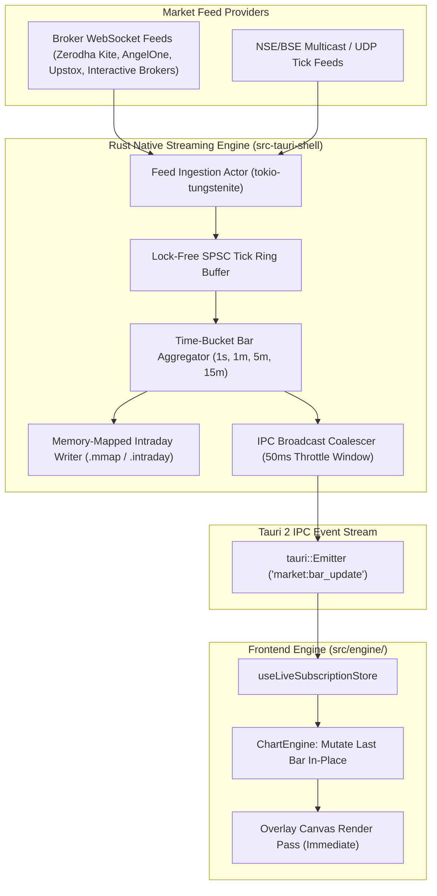

# Intraday & Real-Time Streaming Architecture Roadmap

## 1. Executive Summary & Objective

This architectural blueprint defines the engineering roadmap to expand the **EOD Charting Platform** into a high-throughput, sub-second real-time streaming platform capable of handling **1-second to multi-minute intraday bars** across 2,000+ active Indian instruments simultaneously.



---

## 2. Low-Latency Binary Intraday Format (`.intraday`)

To avoid SQLite write lock bottlenecks during market hours (when 10,000+ ticks arrive per second), intraday bars will be logged directly to memory-mapped `.intraday` binary files.

### 2.1 Intraday Record Layout (48 Bytes Fixed)

| Offset (Bytes) | Field Name | Data Type | Description |
|---|---|---|---|
| `0x00 .. 0x07` | `epoch_ms` | `u64` (Little-Endian) | Unix epoch timestamp in milliseconds |
| `0x08 .. 0x0F` | `open` | `i64` (Scaled x10000) | Scaled bar open price |
| `0x10 .. 0x17` | `high` | `i64` (Scaled x10000) | Scaled bar high price |
| `0x18 .. 0x1F` | `low` | `i64` (Scaled x10000) | Scaled bar low price |
| `0x20 .. 0x27` | `close` | `i64` (Scaled x10000) | Scaled bar close price |
| `0x28 .. 0x2F` | `volume` | `u64` (Little-Endian) | Interval traded share volume |
| `0x30 .. 0x37` | `vwap` | `i64` (Scaled x10000) | Volume-Weighted Average Price |

### 2.2 Memory-Mapped Ring Buffer Architecture
* Each trading day allocates an active memory-mapped file (`data/intraday/YYYY-MM-DD/<SYMBOL>.intraday`).
* A standard 375-minute Indian trading session (09:15 to 15:30 IST) generates **375 1-minute bars (18 KB)** or **22,500 1-second bars (1.08 MB)** per instrument.
* Memory usage remains ultra-lightweight: tracking 500 active watchlist symbols in RAM requires less than **550 MB**.

---

## 3. Real-Time Tick Aggregation & Coalescing

### 3.1 Aggregation State Machine
```rust
pub struct IntradayBarAggregator {
    timeframe_seconds: u64,
    current_bucket_start_ms: u64,
    open: i64,
    high: i64,
    low: i64,
    close: i64,
    volume: u64,
    cumulative_pv: f64,
}

impl IntradayBarAggregator {
    pub fn process_tick(&mut self, tick_time_ms: u64, price: i64, qty: u64) -> Option<IntradayBar> {
        let bucket_start = (tick_time_ms / (self.timeframe_seconds * 1000)) * (self.timeframe_seconds * 1000);
        
        if bucket_start > self.current_bucket_start_ms {
            let completed_bar = self.finalize_bar();
            self.start_new_bucket(bucket_start, price, qty);
            return Some(completed_bar);
        }

        self.high = self.high.max(price);
        self.low = self.low.min(price);
        self.close = price;
        self.volume += qty;
        self.cumulative_pv += (price as f64 / 10000.0) * (qty as f64);
        None
    }
}
```

---

## 4. Frontend In-Place Bar Mutation & IPC Throttling

### 4.1 The Webview IPC Bottleneck
Pumping 1,000 raw WebSocket ticks per second individually across the Tauri Webview bridge causes Webview event queue saturation and garbage collection jank.

### 4.2 Mitigation: 50ms Throttled Batching
1. **Rust IPC Coalescer**:
   * The Rust backend aggregates live updates across active subscribed instruments into a single batched event emitted at **20 Hz (every 50ms)**.
2. **In-Place Last Bar Mutation (Frontend)**:
   * When an update arrives for the active forming bar, `ChartEngine` mutates the last element of `bars[]` in-place without cloning the entire historical array.
   * `ChartCanvas` triggers a localized overlay redraw pass, keeping frame rendering times under **2ms**.
3. **Historical Rollup at Market Close**:
   * At 15:30 IST, the completed day's aggregated intraday bars are rolled into a single EOD bar and atomically appended to the primary `.eod` binary database.
