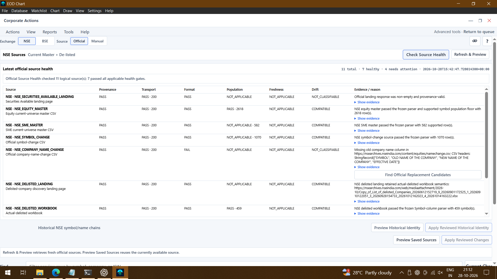
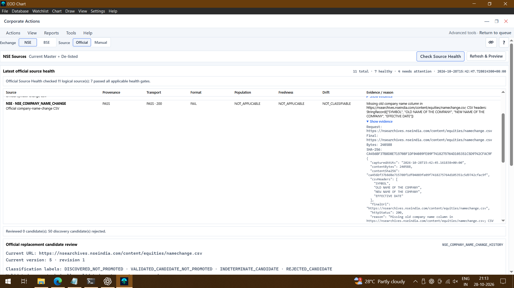
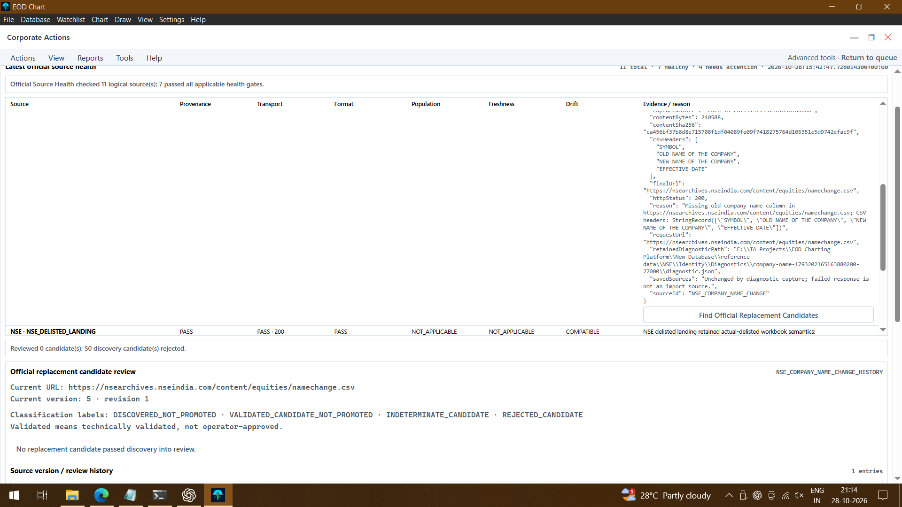
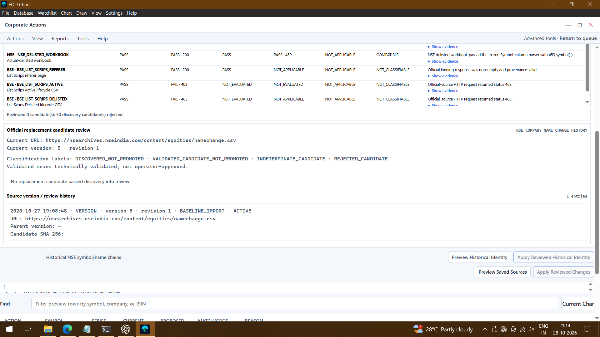

# Identity Import redesign proposal

Status: approved plan implemented; native acceptance remains open. See
[implementation and validation receipt](IMPLEMENTATION.md). The original screenshot
findings and proposal below remain the design rationale.
Project: `E:\TA Projects\EOD Charting Platform`.

## Goal

Make it easy to preview identity changes, understand blockers and deliberately
apply reviewed changes. Preserve the existing desktop visual style, official/manual
source choice, NSE/BSE identifiers and independent current/historical Apply gates.

## Evidence and findings

These are user-supplied desktop screenshots, copied exactly and inspected locally.
They show four states, not an independently exercised end-to-end journey.

1. **Health overview — needs improvement.** The source table takes most of the
   viewport, leaving the preview below the fold. NSE is selected but the headline
   aggregates all 11 NSE/BSE checks. Keep all-source visibility in diagnostics and
   label the scope of every total. Textual statuses and explicit disabled Apply
   actions are useful strengths to preserve.

   

2. **Expanded evidence — poor task hierarchy.** Raw JSON expands one evidence cell
   into a very tall row, leaving most columns blank and introducing nested scrolling.
   The Phase 1A instrumentation supplied useful evidence, but its inline presentation
   needs replacing with a dedicated inspector.

   

3. **Recovery review — unclear next action.** Replacement-source discovery and
   technical classification labels consume the primary workspace even though the
   response arrived successfully. The captured failure is a parser compatibility
   problem. Present that explanation before offering source-replacement maintenance.
   Do not remove the maintenance workflow or its approval requirements.

   

4. **Preview and Apply — difficult to reach.** Source-version history appears above
   historical/current preview actions and the Find field. Users must scroll past
   maintenance details to reach their main task. Multiple scroll regions also pose
   navigation and zoom risks, which need keyboard and native testing.

   

## Confirmed parser finding

Read the retained receipt and first response line in
`New Database/reference-data/NSE/Identity/Diagnostics/company-name-1793202165163880200-27000/`.
The response was HTTP 200, 240588 bytes, SHA-256
`ca456bf37b8d8e715708f1df04089fe09f7418275764d105351c5d9742cfac9f`.
Headers are `SYMBOL`, `OLD NAME OF THE COMPANY`, `NEW NAME OF THE COMPANY`,
`EFFECTIVE DATE`. The current alias list does not recognize the two company-name
headers. This explains the reported missing-column error; it does not establish
that every subsequent data row will pass validation. No fresh download is needed
to reproduce this header failure.

## Proposed workspace

Retain the compact desktop styling and existing Corporate Actions navigation.

| Area | Content and behavior |
| --- | --- |
| Header | Identity Import title; exchange and Official/Manual selectors; active database label |
| Workspace tabs | Current universe; Historical identity where supported; Source diagnostics |
| Preview toolbar | Existing Refresh & Preview and Preview Saved Sources for current universe; historical view uses its existing historical preview operation |
| Compact source status | Selected exchange, last health-check time, saved-source availability/freshness, concise blocker, View diagnostics action |
| Main area | Search/filter and preview table; selected row opens identity evidence details |
| Review footer | Reviewed/blocked counts and the Apply action for the active preview only; stays visible when rows scroll |
| Source diagnostics | Compact source list with source name, exchange, status, count, checked time and Details action |
| Diagnostic inspector | Plain explanation first, followed by structured headers/status/URLs/hash/path; raw JSON behind a separate disclosure |
| Maintenance | Replacement-source discovery and source-version history inside Source diagnostics, separate from identity review |

Keep checked-online health distinct from saved-source availability. A passing online
check must not imply that the source is saved, that preview is loaded, or that Apply
is authorized. Switching view or source must preserve current fingerprint and
review-authority invalidation rules. Display existing health results by selected
exchange without implying that the existing all-source check command became scoped.

Example blocker: “Company-name source downloaded, but its column names are not
recognized. Preview is blocked. Saved sources were not replaced.” Details retain
the exact technical evidence. Avoid recommending replacement-source discovery as
the primary action for a demonstrated parser mismatch.

## States and acceptance criteria

- Distinguish Not previewed, Loading, Loaded with no changes, Filtered with no
  matches, Blocked, Failed and Ready for review. Never substitute zero for unknown.
- Keep preview search, table and review action reachable at 1280x720 and 1920x1080;
  verify Windows scaling and 200% zoom. Use a bounded table scroll region rather
  than stacking full-page, source-table and expanded-record scroll regions.
- Keep diagnostic rows compact regardless of payload size. The inspector has its
  own accessible heading, close action, keyboard support and focus restoration.
- Explain disabled Apply states. Require the same reviewed fingerprint, backend
  recheck and deliberate confirmation as today. View changes must not grant Apply.
- Current and historical identity remain distinct operations; financial Approve
  remains in the Corporate Actions queue. No automatic Apply or financial approval.
- Preserve manual archive workflows, official identifiers, supported series,
  last valid source files and raw prices.
- Use text with status color; verify labels, focus order, tab semantics, screen-reader
  announcements and contrast in native acceptance. Screenshots do not certify these.

## Bounded implementation order

1. **Phase 1B:** add only the two observed company-name aliases, use a fixture
   derived from the retained response, and verify malformed/ambiguous inputs still
   fail closed. Evaluate subsequent row errors before claiming full-source success.
2. **Renderer restructuring:** extract focused Identity Import workspace components
   from `src/components/DatabaseToolsDialogs.tsx`; introduce the workspace tabs,
   compact source summary, diagnostics inspector and visible review footer. Reuse
   existing platform APIs and reviewed Apply handlers. No new backend fetch/approval
   orchestration in this pass.
3. **Focused checks and native acceptance:** affected Rust parser tests for Phase 1B;
   focused UI state/interaction checks plus renderer validation for the layout;
   then user-rebuilt portable acceptance against the states and viewport criteria.

Primary inspected code: `DatabaseToolsDialogs.tsx` Identity Import rendering and
source-health actions; `nse_identity_imports.rs` company-name aliases. This proposal
does not certify approval correctness or change the earlier broader audit scope.

## Work performed and limits

Only this document and copies of the four supplied screenshots were created under
`docs/`. The retained diagnostic was read without opening SQLite or invoking import.
No application-source edits, network requests, tests, builds, imports or approvals
were performed. Native keyboard behavior, smaller-window layout and an actual
populated preview were not exercised. The proposed layout is not yet implemented
or visually accepted.
